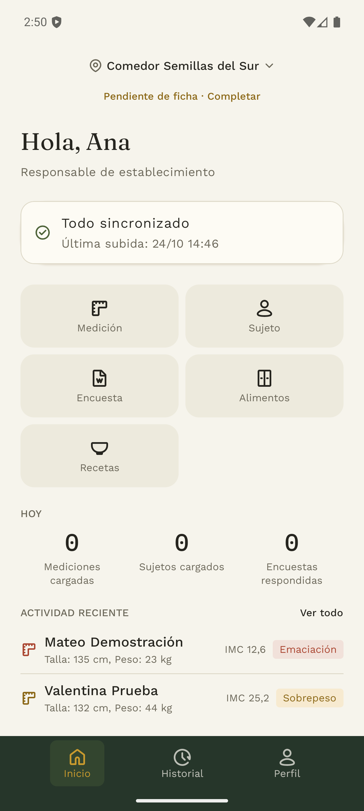
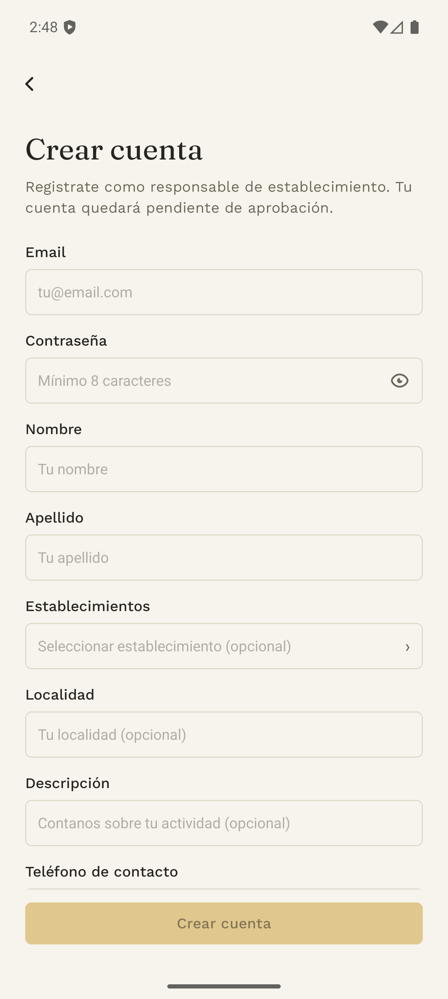
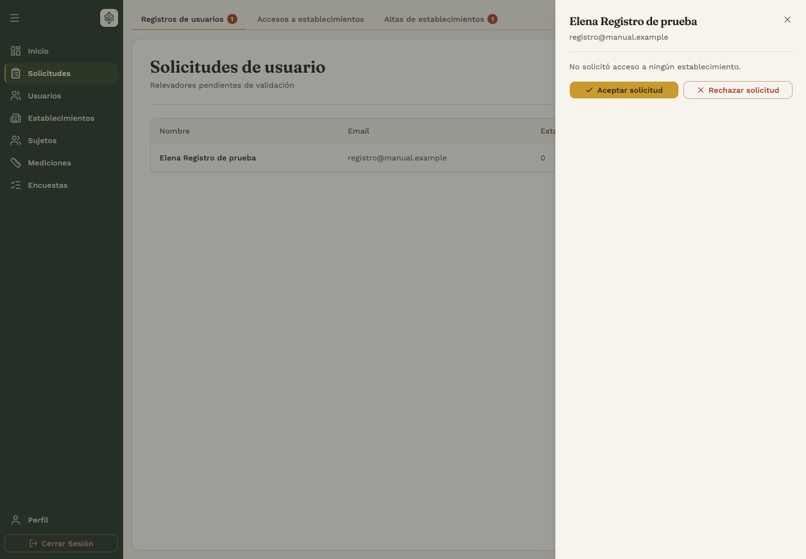
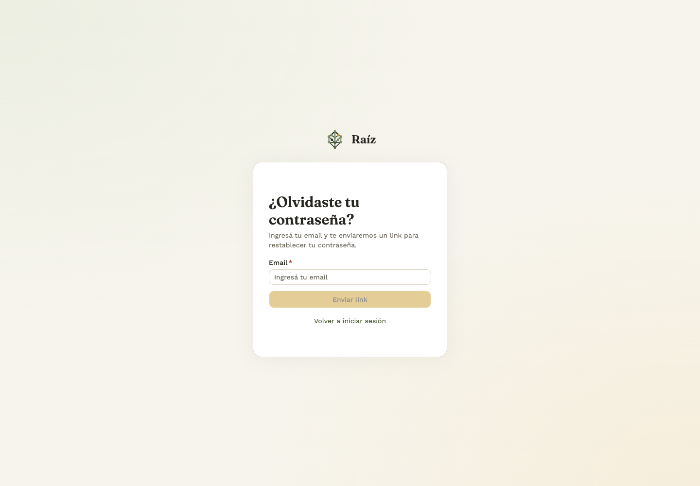
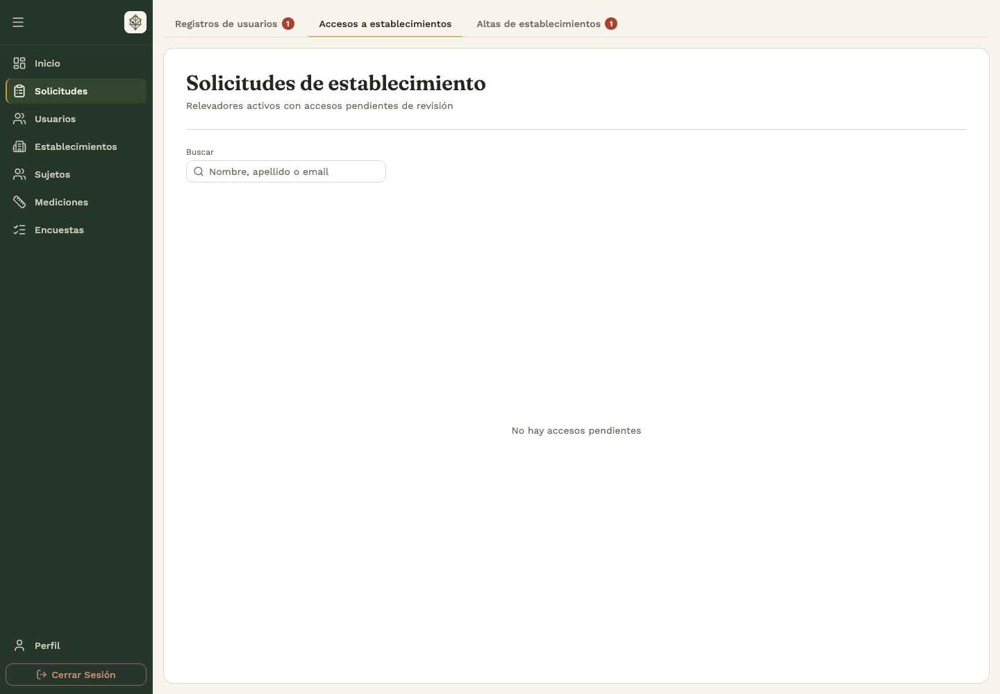
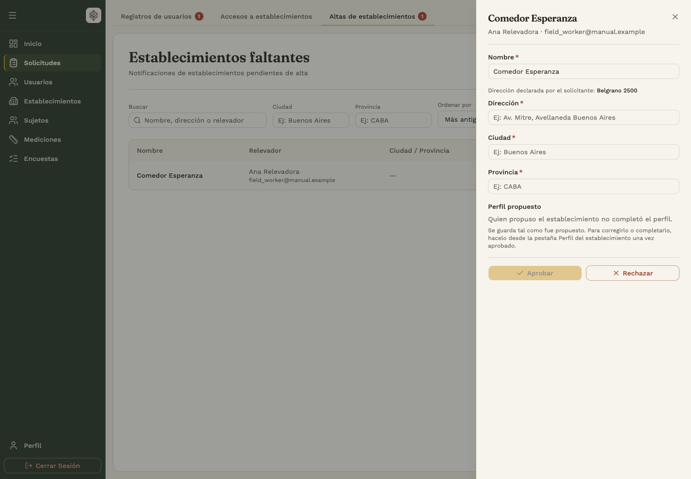
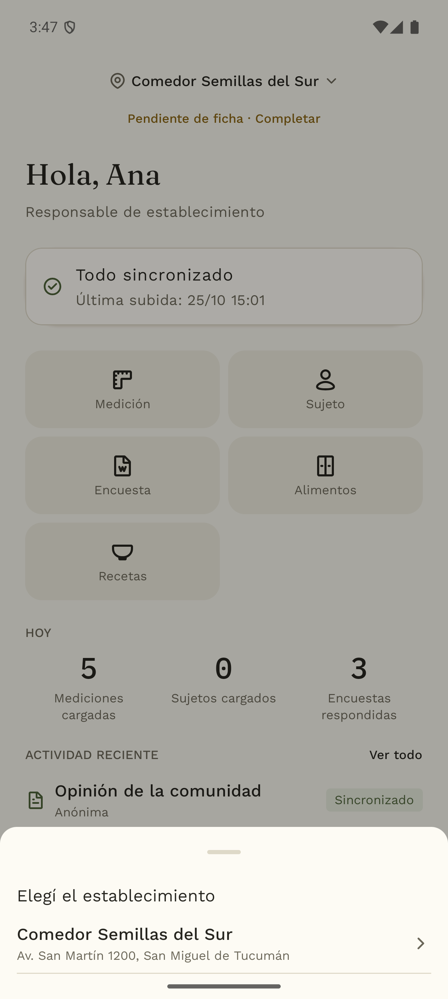
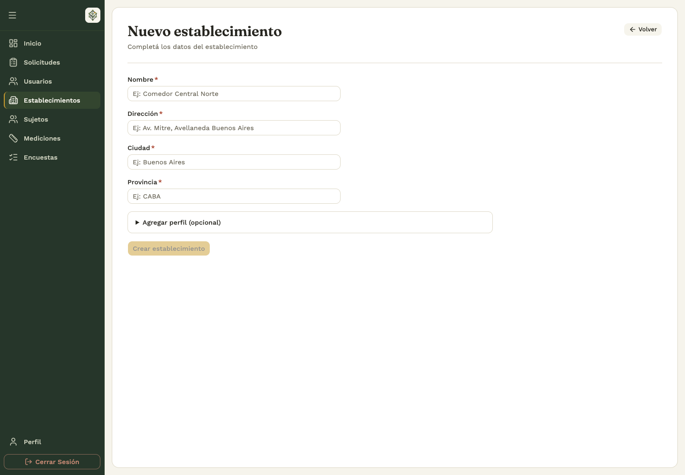
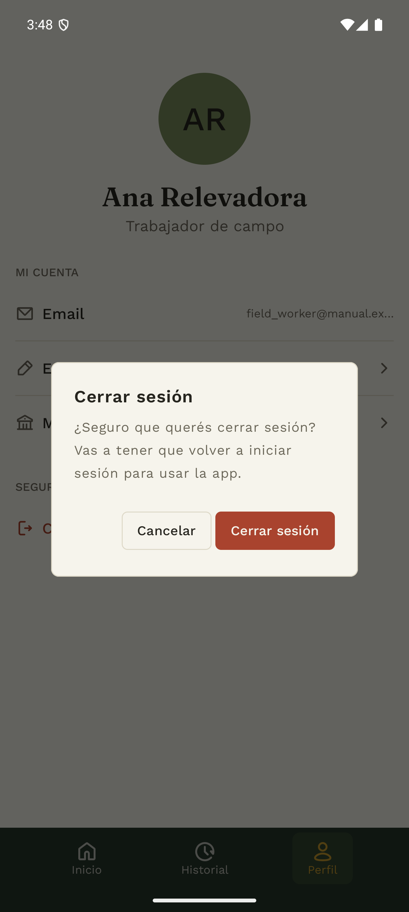

# 1. Acceso y trabajo en equipo

## 1.1 Elegir dónde trabajar

El **relevador** usa la app móvil. Los **administradores y analistas** pueden entrar al backoffice. El panel web avisa a los relevadores que deben ingresar desde la app.

En la app, **Inicio**, **Historial** y **Perfil** están en la barra inferior. Inicio reúne los accesos a Medición, Sujeto, Encuesta, Alimentos y Recetas. En el backoffice, el menú lateral reúne las secciones disponibles para tu rol.

## 1.2 Registrarse como relevador

**Quién:** quien va a cargar datos en el comedor. **Dónde:** app.

1. En la bienvenida, tocá **Crear cuenta**.
2. Completá email, contraseña, nombre y apellido.
3. Si ya sabés dónde vas a trabajar, seleccioná uno o más establecimientos. Este paso es opcional.
4. Si corresponde, agregá localidad, descripción y teléfono de contacto.
5. Tocá **Crear cuenta** y revisá el aviso de registro enviado.
6. Abrí el correo de verificación y confirmá tu email.
7. Esperá la aprobación de la cuenta por un administrador antes de iniciar sesión.

La verificación del email y la aprobación de la cuenta son pasos diferentes. Una cuenta creada todavía puede estar pendiente de aprobación. Seleccionar un comedor durante el registro tampoco significa que el acceso haya sido aprobado.

Si el correo ya está registrado, usá **Iniciar sesión** o la recuperación de contraseña. Si alguno de los establecimientos ya no está disponible, revisá la selección y volvé a enviar el formulario.

## 1.3 Aprobar una cuenta y decidir sus accesos

**Quién:** administrador. **Dónde:** backoffice → **Solicitudes → Registros de usuarios**.

1. Buscá el registro pendiente y elegí **Revisar**.
2. Comprobá los datos y el aviso de email sin verificar, si aparece.
3. Decidí qué establecimientos aceptar, cuáles rechazar y cuáles dejar pendientes.
4. Elegí **Aceptar solicitud** y confirmá para activar la cuenta con las decisiones tomadas.
5. Para rechazar el registro completo, elegí **Rechazar solicitud** y confirmá.

Los accesos que dejás sin decidir siguen pendientes. Se resuelven después en **Accesos a establecimientos**. Si se informa una aprobación parcial, revisá esa pestaña antes de dar por terminada la tarea.

## 1.4 Iniciar sesión y recuperar la contraseña

**Dónde:** app → **Iniciar sesión**, o página de acceso del backoffice.

1. Ingresá el email y la contraseña de tu cuenta.
2. Elegí **Iniciar sesión**.
3. Si la cuenta está pendiente, solicitá al administrador que revise tu registro.
4. Si olvidaste la contraseña, elegí **¿Olvidaste tu contraseña?**, ingresá el email y seguí el enlace del correo.
5. Definí la nueva contraseña y volvé a iniciar sesión.

En el formulario web, los requisitos de contraseña se muestran junto al campo. Si un enlace venció o ya se usó, solicitá uno nuevo. Si el sistema pide esperar tras varios intentos, respetá el plazo indicado antes de reintentar.

Si la sesión vence durante el trabajo, iniciá sesión nuevamente. No vuelvas a cargar un registro sin revisar primero su estado en Historial.

## 1.5 Solicitar acceso a otro establecimiento

**Quién:** relevador o analista. **Dónde:** app → **Perfil → Mis establecimientos**, o backoffice → **Perfil → Mis establecimientos**.

1. Elegí **Solicitar acceso** y buscá el comedor por su nombre o dirección.
2. Seleccionalo y enviá la solicitud.
3. Revisá el estado **Pendiente**, **Aprobado** o **Rechazado**.
4. Cuando el administrador lo apruebe, volvé a Inicio y elegí ese establecimiento.

El administrador decide el acceso desde **Solicitudes → Accesos a establecimientos → Revisar**. Puede aceptar o rechazar cada vínculo y aplicar los cambios. La aprobación de la cuenta y la de cada comedor se administran por separado.

Para dejar de trabajar en un comedor, usá la acción de retiro o baja de **Mis establecimientos** y confirmá. Un administrador puede quitar el acceso desde la ficha del usuario o la pestaña **Relevadores** del comedor. Si te revocaron el acceso, solicitá su revisión antes de continuar.

Los administradores usan **Suscribirme / Desuscribirme** en lugar de solicitar una aprobación. La suscripción identifica sus establecimientos de interés.

## 1.6 Notificar un comedor que no aparece

**Dónde:** app → **Perfil → Mis establecimientos → Solicitar acceso → ¿No encontrás tu comedor? Notificar**.

1. Completá el nombre y la dirección; agregá ciudad y provincia si las conocés.
2. Tocá **Siguiente** para completar la ficha del comedor, o dejala para después con **Contestar luego**.
3. Enviá la solicitud.
4. Un administrador la revisa en **Solicitudes → Altas de establecimientos** del backoffice.
5. Al aprobarla, el administrador completa o corrige la ubicación y los datos solicitados. El comedor queda disponible y se otorga el acceso correspondiente a quien lo propuso.

Si el lugar ya existe, el sistema puede reutilizarlo para evitar un duplicado. El rechazo de una propuesta no crea el establecimiento. Una solicitud ya resuelta no se vuelve a aprobar: revisá su estado antes de reintentar.

Un analista también puede usar **Establecimientos → Proponer establecimiento** en el panel web.

## 1.7 Elegir el comedor antes de cargar

En **Inicio** de la app, tocá el nombre del establecimiento o **Elegí el establecimiento**. Seleccioná el lugar en el que estás trabajando y verificá el nombre antes de registrar mediciones o alimentos.

Cambiar el comedor cambia el contexto de las nuevas tareas. No mueve los registros que ya se guardaron en otro establecimiento. Si un formulario muestra su propio selector, comprobá también ese campo.

## 1.8 Crear, localizar y completar un establecimiento

**Quién:** administrador para el alta y la edición de nombre/dirección. **Dónde:** backoffice → **Establecimientos**.

1. Elegí **Nuevo establecimiento**.
2. Completá el nombre y buscá la dirección.
3. Seleccioná una sugerencia de dirección para fijar la ubicación y verificá ciudad y provincia.
4. Completá la ficha opcional si ya contás con esa información y guardá.
5. Buscá el nuevo registro en la lista y abrilo para revisar sus datos.

La lista permite buscar y ordenar. La vista **Mapa** muestra los establecimientos con ubicación disponible y una leyenda de estados. Si un lugar no aparece en el mapa, revisá la lista y su ubicación.

Desde la ficha, **Editar datos** permite corregir nombre y ubicación. La pestaña **Perfil** permite ver o completar la caracterización: ubicación y contacto, tipo de espacio, servicios, asistentes, alimentación y comunidad.

En la app, el responsable con acceso aprobado puede abrir la ficha desde **Mis establecimientos** o el aviso **Pendiente de ficha · Completar**. Los campos son opcionales: completá lo que conozcas y guardá. «Perfil completo» indica que la ficha tiene información; revisá el contenido antes de asumir que todos sus campos fueron respondidos.

## 1.9 Invitar usuarios y administrar roles

**Quién:** administrador. **Dónde:** backoffice → **Usuarios**.

1. Abrí la lista de **Administradores** o **Analistas** y elegí la acción de invitación.
2. Ingresá el email y enviá la invitación.
3. La persona abre el enlace, completa sus datos y crea su contraseña para activar la cuenta.
4. Si no la recibió, usá **Reenviar invitación** cuando la pantalla lo permita.

Si el email ya tiene una cuenta, el panel informa esa situación. Una invitación pendiente no equivale a una cuenta activada.

Abrí un usuario para ver su perfil, estado y establecimientos. **Cambiar rol** ofrece únicamente los roles que tu cuenta puede asignar. Un administrador no puede cambiar el rol de otro administrador ni del superadministrador; el superadministrador dispone de permisos adicionales. No podés cambiar tu propio rol desde ese diálogo.

## 1.10 Editar el perfil y cerrar sesión

En **Perfil → Editar perfil**, modificá los datos que el formulario habilita y guardá. El email y el rol son datos de consulta en la edición del perfil personal.

Para salir, elegí **Cerrar sesión** y confirmá cuando la app lo solicite. Antes de cambiar de cuenta o dispositivo, comprobá en Inicio e Historial que tus cargas estén sincronizadas. La copia pendiente en un teléfono no reemplaza el registro disponible para el resto del equipo.

**En esta versión, cerrar sesión voluntariamente borra los datos locales de la app, incluidas las cargas que todavía no se sincronizaron.** Esperá a que terminen de subir antes de confirmar la salida. Un vencimiento de sesión es distinto: volvé a ingresar y revisá las cargas pendientes.

