# 2. Talla y Peso

## Recorrido completo

**Relevador, app:** elegir comedor → buscar o crear sujeto → cargar y revisar medidas → guardar → sincronizar.

**Analista o administrador, backoffice:** localizar la medición → consultar el sujeto y su evolución → revisar el estado del establecimiento → exportar si hace falta.

## 2.1 Registrar un sujeto

**Antes de empezar:** tené a mano los datos de la persona y buscala primero para evitar registrar dos veces a la misma persona.

1. En Inicio, tocá **Sujeto**. También podés elegir **Crear sujeto nuevo** al buscar a alguien desde una medición.
2. Ingresá el **DNI** sin puntos, **Nombre**, **Apellido** y **Fecha de nacimiento** en formato día/mes/año.
3. Elegí **Sexo** y completá las opciones **Población rural** y **Población indígena** según corresponda.
4. Tocá **Guardar** y verificá el aviso de guardado.
5. Si llegaste desde la selección de una medición, continuá con el sujeto recién creado.

La fecha de nacimiento no puede ser futura. Revisá los mensajes debajo de cada campo si el formulario no permite guardar. Si ya existe una persona con ese DNI, revisá el registro existente antes de crear otra.

Si una carga local se reconcilia con una persona que ya estaba registrada, Historial muestra **Ya existía**. Revisá el resultado antes de repetir el alta.

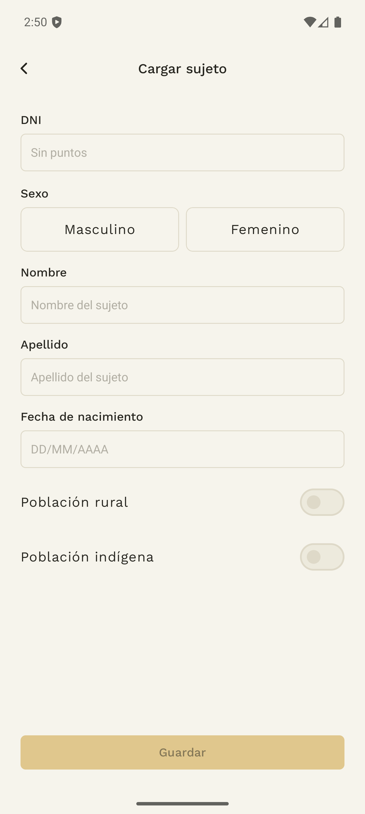

## 2.2 Buscar al sujeto y preparar la medición

**Dónde:** app → Inicio → **Medición**.

1. Tocá **Seleccionar sujeto**.
2. Buscá por nombre o DNI y elegí la persona correcta.
3. Confirmá el nombre y el DNI que aparecen en el encabezado del formulario.
4. Si elegiste otra persona por error, tocá **Cambiar**.
5. Revisá el establecimiento de la medición. Debe ser el lugar al que corresponde esta carga.

La búsqueda de sujetos existentes consulta al servidor. En esta versión, haber abierto el listado antes no garantiza poder volver a buscar sin conexión. Seleccioná al sujeto con conexión antes de continuar la medición, o usá la creación de un sujeto desde el formulario cuando corresponda. Si aparece **No se pudieron cargar los sujetos**, recuperá conexión y tocá **Reintentar**.

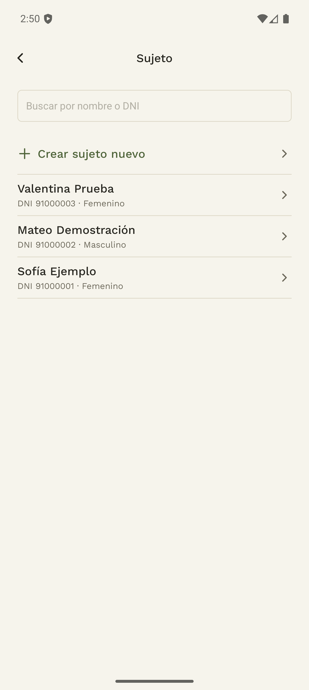

## 2.3 Cargar peso, talla y observaciones

1. Completá **Peso (kg)** y **Talla (cm)**. No ingreses la talla en metros.
2. Si hace falta, agregá una **Observación (opcional)** de hasta 500 caracteres.
3. Revisá la **Fecha de medición** que muestra el formulario. La app asigna el momento de la carga; ese campo no es un selector de fecha retroactiva.
4. Tocá **Guardar**.
5. Comprobá **Medición guardada** y después el estado de sincronización.

El formulario controla campos vacíos y valores fuera del rango permitido. Corregí el valor señalado y volvé a guardar. Si falla el guardado local, conservá los datos del formulario para reintentar.

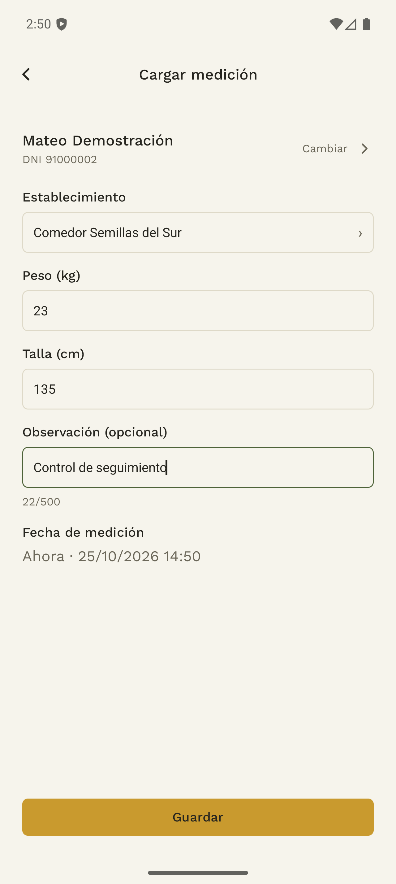

## 2.4 Revisar una medición que genera una alerta

Si los valores ingresados generarían una alerta, la app muestra **Revisá las medidas** antes de guardarlos.

1. Compará el peso y la talla del diálogo con los valores que pretendías ingresar.
2. Elegí **Corregir** si hay un error. Los datos permanecen en el formulario.
3. Si los valores son los que querés registrar, elegí **Confirmar y guardar**.
4. Revisá el aviso de guardado y su sincronización.

Cerrar el diálogo o volver atrás no confirma la carga. Cambiar el sujeto, el comedor o las medidas obliga a revisar la nueva combinación antes de confirmar. Las medidas que no requieren esa revisión se guardan directamente.

La alerta mostrada en esta instancia se calcula con los datos conocidos por la app. El resultado del registro sincronizado es el que podrá consultar el equipo en el sistema.

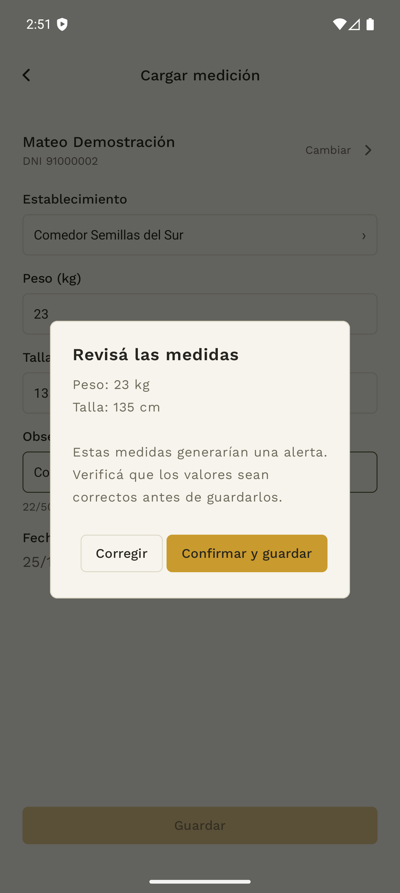

## 2.5 Cargar sin conexión y comprobar la subida

La app permite guardar sujetos y mediciones en el dispositivo y subirlos al recuperar conexión. No hace falta repetir la carga por el solo hecho de estar sin internet.

| Aviso de Inicio | Qué hacer |
|---|---|
| **Todo sincronizado** | Las colas no muestran cargas pendientes. Consultá Historial si necesitás comprobar un registro concreto. |
| **Sin conexión** y registros que «se subirán al reconectar» | Conservá el dispositivo y recuperá conectividad para subirlos. |
| **Sin subir / Sincronizar** | Tocá **Sincronizar** y esperá el resultado. |
| **Sincronizando…** | Esperá a que termine antes de dar por finalizado el trabajo. |
| **Con error** | Abrí Historial, revisá la causa y usá la acción de reintento disponible. |

En **Historial**, seleccioná el tipo de carga y revisá sus estados. Una persona creada sin conexión debe sincronizarse antes que sus mediciones asociadas; la app coordina esa secuencia.

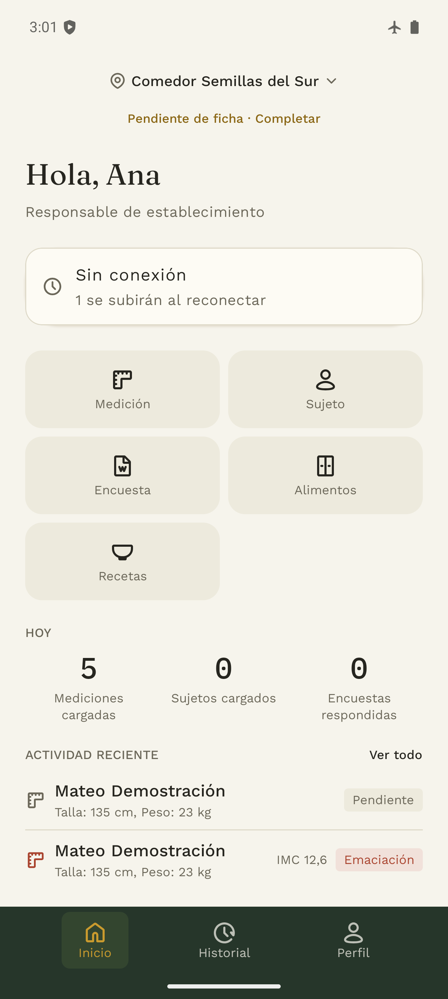

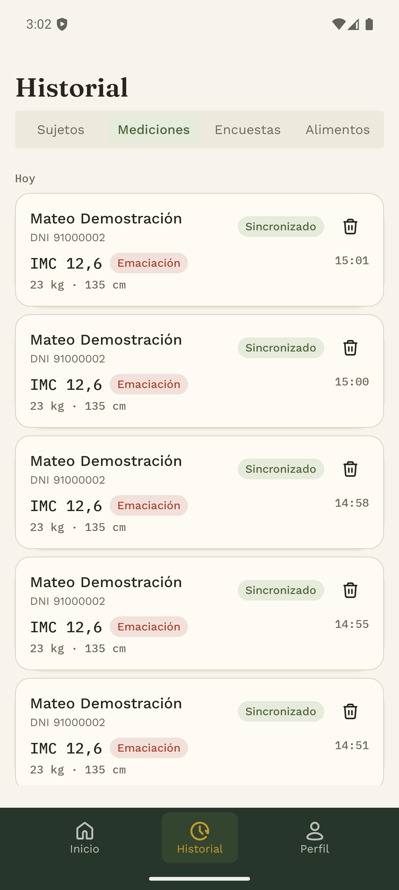

No borres datos de la aplicación ni la reinstales para resolver una carga pendiente. Si el error persiste, comunicá al equipo qué registro y qué mensaje aparecen.

La acción **Eliminar** de un historial local requiere especial cuidado: quitar una carga del teléfono no es un procedimiento para borrar una medición ya registrada en el sistema. No elimines una carga pendiente que todavía necesitás enviar.

## 2.6 Consultar sujetos desde el backoffice

**Quién:** analista o administrador. **Dónde:** **Sujetos**.

1. Buscá por nombre, apellido o documento.
2. Abrí **Filtros** para acotar por fecha de nacimiento, establecimiento, zona rural, población indígena o sexo.
3. Ordená el listado y cambiá de página si hace falta.
4. Abrí la fila de una persona para ver sus datos y el último relevamiento.

En el listado general, el último relevamiento puede pertenecer a cualquiera de los comedores. En la ficha de un establecimiento, la lectura de sus sujetos se refiere al último relevamiento **en ese comedor**. Comprobá el contexto antes de comparar las dos pantallas.

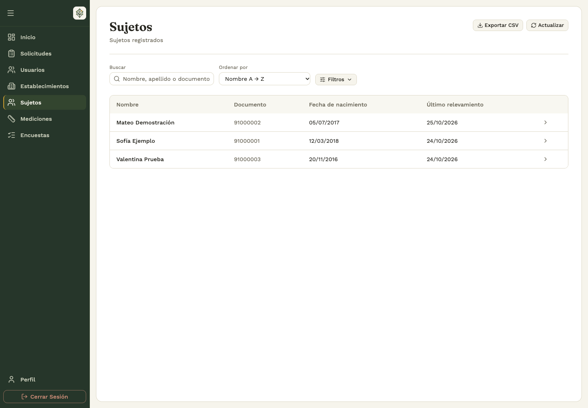

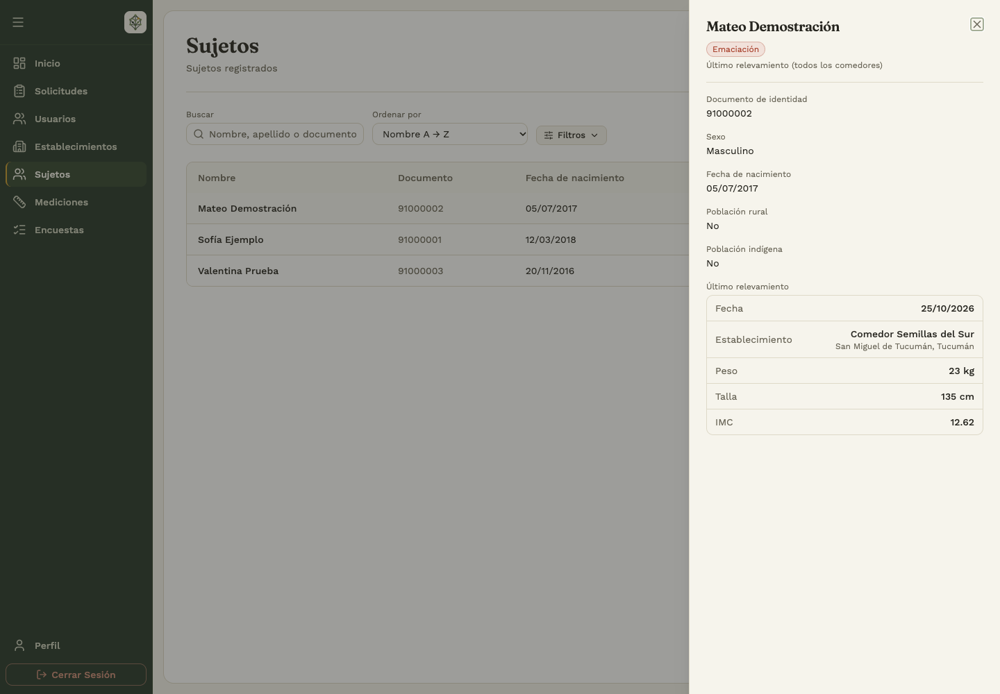

## 2.7 Consultar mediciones y evolución

**Dónde:** backoffice → **Mediciones**.

1. Revisá peso, talla, IMC, fecha, sujeto, comedor, responsable, alertas y observaciones.
2. Usá los filtros de fechas, edades y ubicación que muestra la pantalla para acotar la búsqueda.
3. Elegí el orden que te resulte útil y tocá **Actualizar** para consultar las últimas cargas.
4. Abrí una fila para ver la **Evolución** de esa persona, con el gráfico de peso y talla y las observaciones disponibles.

Si una carga de la app no aparece, revisá primero que esté sincronizada y después comprobá filtros, fechas y establecimiento. Un rango con la fecha inicial posterior a la final, o la edad mínima mayor que la máxima, debe corregirse antes de consultar.

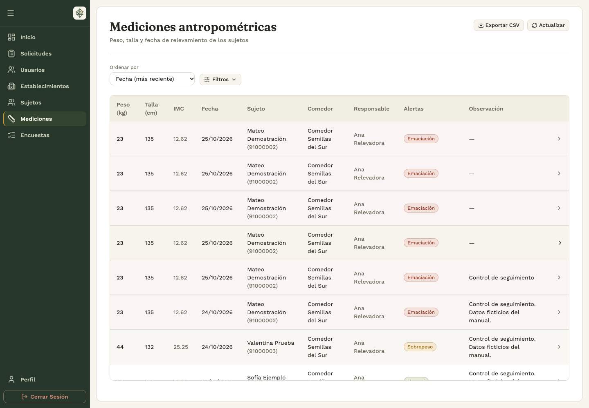

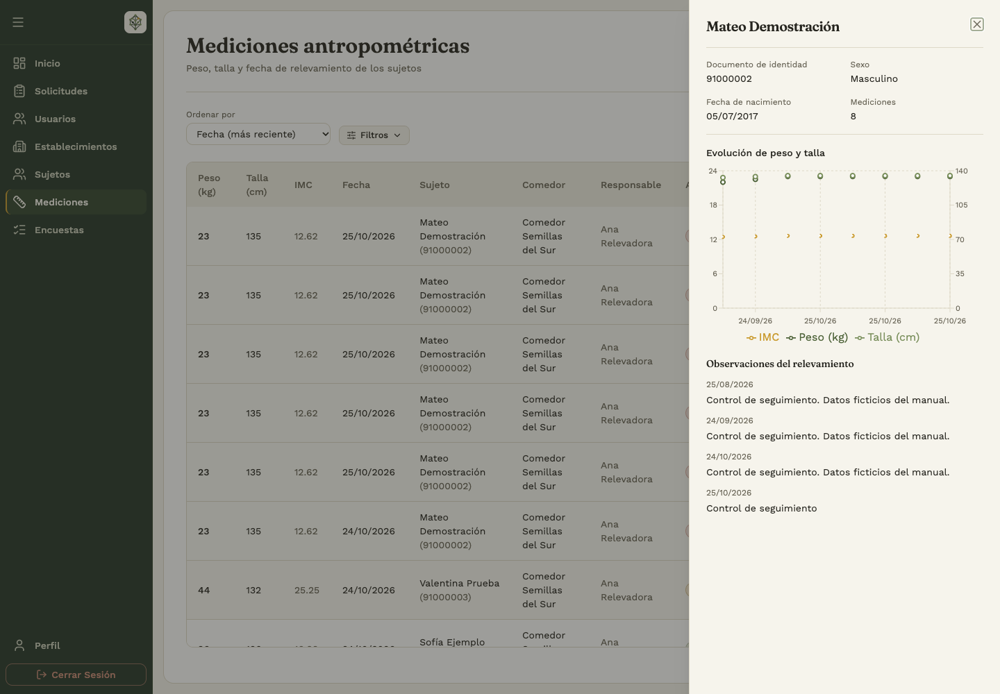

## 2.8 Revisar el establecimiento y exportar

En **Establecimientos**, abrí el comedor. La cabecera resume sus sujetos, promedios, último relevamiento y estado de alerta. La pestaña **Sujetos** permite revisar los registros que componen ese contexto.

**Sin datos** significa que todavía no hay información suficiente para mostrar esa lectura; no equivale a un resultado «Normal».

Las acciones **Exportar CSV** de establecimientos, sujetos y mediciones descargan el listado correspondiente. Configurá primero los filtros y comprobá el archivo descargado. La exportación sirve para continuar el trabajo fuera del panel; la consulta del sistema sigue mostrando las actualizaciones posteriores.

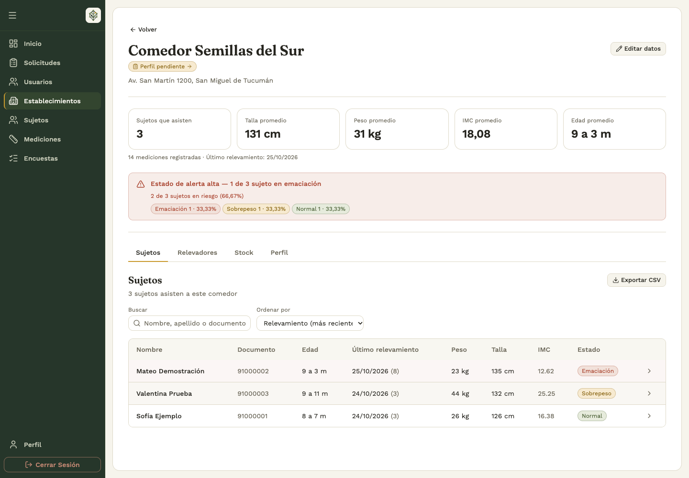
