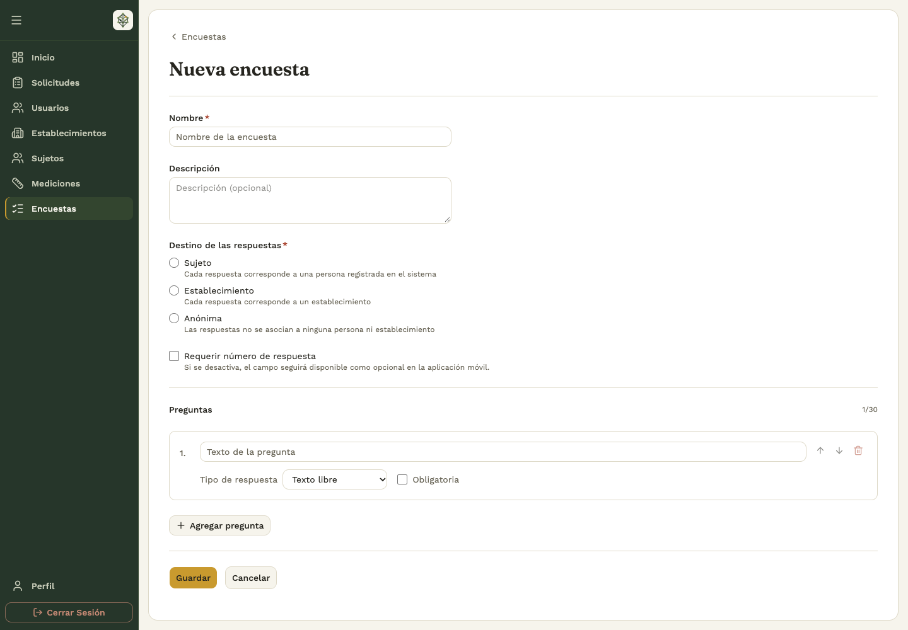
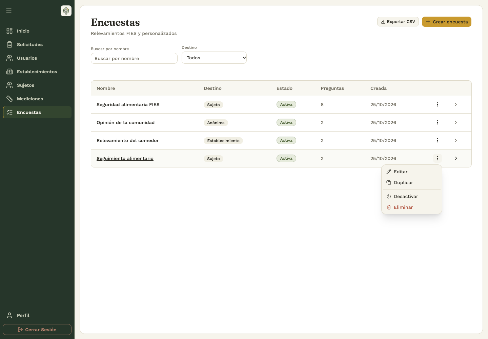
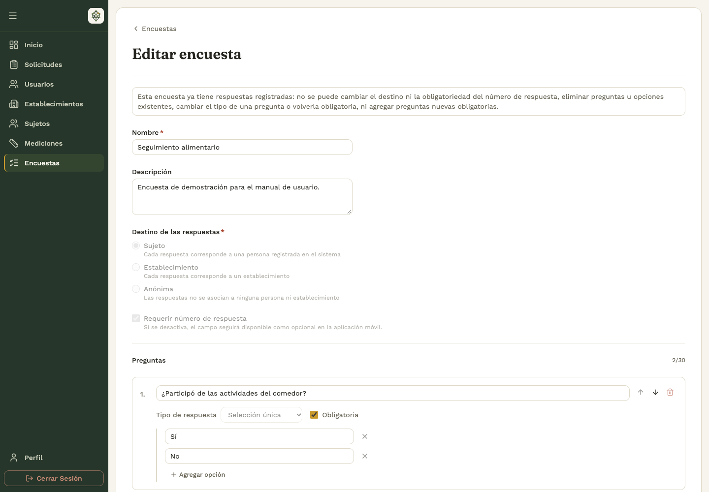
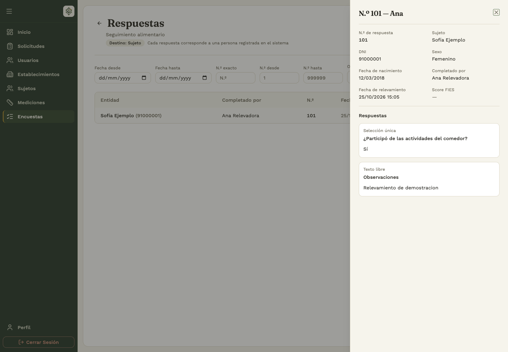

# 3. Encuestas

## Recorrido completo

**Backoffice:** diseñar o partir de FIES → guardar → activar. **App:** elegir la encuesta → identificar el destinatario → responder → guardar y sincronizar. **Backoffice:** consultar respuestas e indicadores → filtrar → exportar.

## 3.1 Crear una encuesta personalizada

**Quién:** administrador o analista. **Dónde:** backoffice → **Encuestas → Crear encuesta**.

1. Completá **Nombre** y, si corresponde, **Descripción**.
2. Elegí el **Destino de las respuestas**:
   - **Sujeto:** cada respuesta se vincula a una persona registrada.
   - **Establecimiento:** cada respuesta corresponde a un comedor.
   - **Anónima:** no se asocia a una persona ni a un establecimiento.
3. Decidí si vas a **Requerir número de respuesta**. Aunque sea opcional, la app conserva el campo.
4. Escribí cada pregunta y elegí su tipo: **Texto libre**, **Selección única**, **Selección múltiple**, **Numérica** o **Fecha**.
5. Marcá **Obligatoria** cuando corresponda. Para preguntas de selección, agregá las opciones necesarias.
6. Usá **Agregar pregunta** para completar el formulario y tocá **Guardar**.

La encuesta admite hasta 30 preguntas. El nombre debe distinguirla de las existentes. Una pregunta de selección necesita opciones; una pregunta de texto, número o fecha no usa una lista de opciones.

## 3.2 Partir de la plantilla FIES

Desde la creación de encuestas, elegí la opción de plantilla **FIES** que ofrece el panel. Revisá las preguntas precargadas, completá el nombre del relevamiento y guardá.

FIES es un instrumento específico: si necesitás conservar su evaluación, mantené la estructura y las respuestas previstas por la plantilla. Para otro cuestionario, usá una encuesta personalizada. El **Score FIES** se consulta cuando corresponde a las respuestas de ese instrumento; no es una puntuación genérica para cualquier encuesta.

## 3.3 Activar, desactivar, duplicar y eliminar

**Dónde:** backoffice → **Encuestas → Más acciones** de la fila correspondiente.

Los administradores pueden modificar cualquier encuesta. Un analista puede modificar las que creó; para cambiar una de otra persona debe coordinar con su autor o con un administrador. La eliminación desde el backoffice está reservada a administradores.

| Acción | Resultado y precaución |
|---|---|
| **Activar** | La encuesta queda habilitada para recibir respuestas. Confirmá la acción. |
| **Desactivar** | Deja de aceptar nuevas respuestas; sus resultados anteriores siguen siendo consultables. |
| **Duplicar** | Crea otra encuesta para preparar un nuevo relevamiento. Revisá el nombre, contenido y estado de la copia. |
| **Editar** | Abre su configuración. Con respuestas registradas se aplican restricciones. |
| **Eliminar** | Disponible según permisos y condiciones. Una encuesta con respuestas no se elimina. Confirmar el borrado es definitivo. |

Para cambiar el instrumento de un relevamiento ya iniciado, prepará una nueva encuesta o duplicala en lugar de alterar el significado de respuestas existentes.

## 3.4 Editar después de recibir respuestas

El formulario muestra un aviso cuando la encuesta ya tiene respuestas. En ese estado no se puede cambiar el destino ni la obligatoriedad del número, eliminar preguntas, cambiar su tipo, volver obligatoria una pregunta opcional o agregar preguntas nuevas obligatorias. El panel también restringe la eliminación de opciones existentes.

Si alguien respondió mientras editabas y el guardado informa un conflicto, recargá la encuesta y revisá las restricciones actuales. No repitas el guardado de una configuración anterior sin revisar el mensaje.

## 3.5 Elegir y responder desde la app

**Antes de empezar:** asegurate de tener cargado el sujeto o de haber elegido el establecimiento, según el destino del cuestionario.

1. En Inicio, tocá **Encuesta** y elegí una encuesta disponible.
2. Si es de sujetos, seleccioná la persona y comprobá su identidad.
3. Si es de establecimientos, verificá el comedor del encabezado. Si es anónima, el formulario indica **Anónima**.
4. Ingresá el **Número de respuesta** si corresponde. El rango admitido es de 1 a 999999.
5. Contestá las preguntas. En selección única elegís una opción; en selección múltiple podés marcar varias.
6. Tocá **Guardar**, corregí los campos señalados y comprobá el resultado.
7. Revisá la sincronización desde Inicio o Historial.

Para un sujeto o establecimiento se admite una respuesta por encuesta. Al guardar, la app vuelve al listado para evitar otra carga para ese mismo destinatario. Las encuestas anónimas permiten realizar varias entrevistas: la app limpia las respuestas y propone el siguiente número.

El número de respuesta sirve para identificar el relevamiento, pero puede repetirse. No reemplaza la comprobación del destinatario.

## 3.6 Responder sin conexión y resolver errores

Con conexión, abrí las encuestas que necesitás antes de ir a terreno. Sin internet, la app muestra **Mostrando encuestas guardadas** y depende de los formularios y destinatarios disponibles en el teléfono.

Las respuestas guardadas localmente se suben al recuperar conectividad. Si la encuesta fue desactivada antes de que la carga llegue al servidor, puede ser rechazada: revisá Historial y coordiná con quien administra el relevamiento.

Si una carga pendiente necesita completar el número, abrí **Agregar número**, ingresá un valor válido y usá **Guardar y reenviar**. Si el destinatario ya respondió, revisá la respuesta existente en lugar de crear otra.

## 3.7 Consultar y corregir una respuesta en la app

Desde **Historial**, entrá a las respuestas de encuestas y abrí el registro. El detalle permite revisar el cuestionario respondido y su número.

Cuando aparece **Editar**, corregí los campos necesarios y elegí **Guardar cambios**. Revisá el estado de la edición y la acción **Reintentar edición** si aparece. Una modificación pendiente todavía debe sincronizarse antes de considerarla compartida con el equipo.

## 3.8 Consultar resultados y exportarlos

**Dónde:** backoffice → **Encuestas → Ver respuestas**.

1. Revisá el destino de la encuesta y la cantidad de respuestas.
2. Usá los filtros de fecha, ubicación, entidad, persona que completó y número de respuesta disponibles para ese relevamiento.
3. Para números, elegí búsqueda exacta o por intervalo; el valor «desde» no puede superar al valor «hasta».
4. Abrí una respuesta para consultar sus preguntas y respuestas completas.
5. Usá **Exportar** para descargar las respuestas en un archivo Excel (`.xlsx`).
6. Comprobá el archivo descargado y que corresponde a la selección filtrada.

La pantalla **Inicio** del backoffice reúne indicadores generales, como cantidad de respuestas y último relevamiento. La ausencia de resultados puede deberse a filtros, a que todavía no hubo respuestas o a que la app no terminó de sincronizar.

