# 4. Nutrir

## Recorrido completo

**App o backoffice:** registrar los alimentos recibidos → revisar el stock → registrar su salida o elegir una receta → comprobar el movimiento y el stock actualizado.

Trabajá siempre sobre el comedor correcto. Los ingresos, egresos y las confirmaciones de recetas requieren conexión; no tienen el mismo circuito de guardado offline que las mediciones.

## 4.1 Abrir Alimentos y consultar existencias

**Dónde:** app → Inicio → **Alimentos**.

La pantalla muestra el stock actual y los últimos movimientos del establecimiento elegido. Desde allí podés **Registrar ingreso**, **Registrar con recibo**, **Registrar egreso**, **Ver todo el stock** o abrir **Recetas con el stock disponible**.

En **Stock**, filtrá por categoría y elegí el orden que te resulte útil. Cada alimento muestra su unidad y cantidad. **Sin alimentos disponibles** indica que no hay existencias para esa consulta; si elegiste una categoría, probá quitar el filtro.

En el backoffice, abrí **Establecimientos → comedor → Stock**. La tabla permite consultar cantidades, categorías, unidades y última actualización, filtrar y descargar **Exportar CSV**.

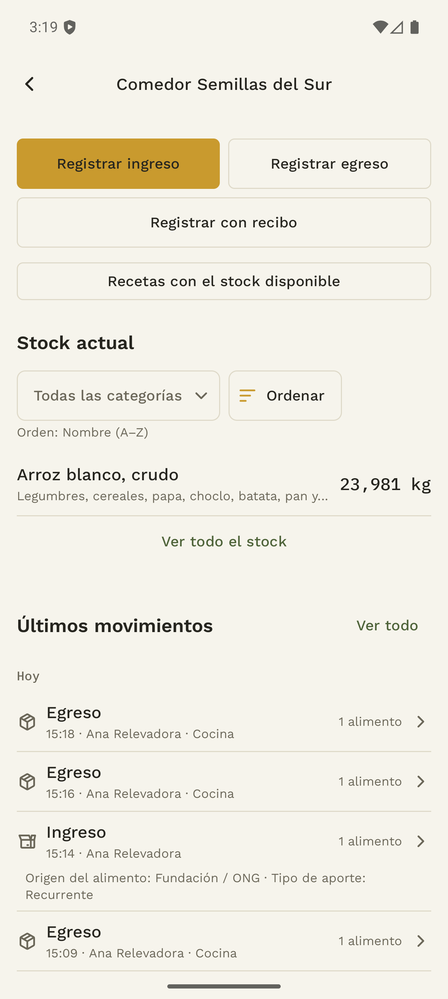

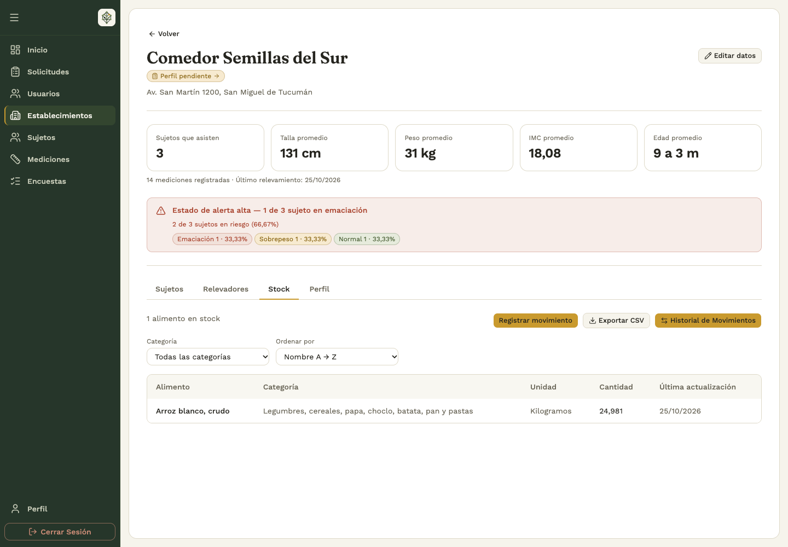

## 4.2 Registrar un ingreso manual desde la app

1. En **Alimentos**, tocá **Registrar ingreso**.
2. Confirmá el establecimiento y completá la **Fecha de recepción**. No puede ser futura.
3. Indicá el **Origen del alimento** y si el aporte es **Único** o **Recurrente**.
4. En **Agregar alimento**, buscá en el catálogo y seleccioná el alimento correcto.
5. Ingresá la cantidad en la unidad que muestra la línea. Repetí el paso para cada alimento recibido.
6. Agregá comentarios si corresponde y tocá **Registrar ingreso**.
7. Comprobá el resultado en el stock y el historial.

El catálogo determina la unidad: kilogramos, litros o unidades. No conviertas una bolsa o una caja a «unidades» si el alimento está expresado en kilogramos; registrá la cantidad en la unidad indicada.

El formulario requiere al menos un alimento y cantidades positivas. Si falla la conexión al guardar, revisá el mensaje y el historial antes de iniciar un ingreso nuevo.

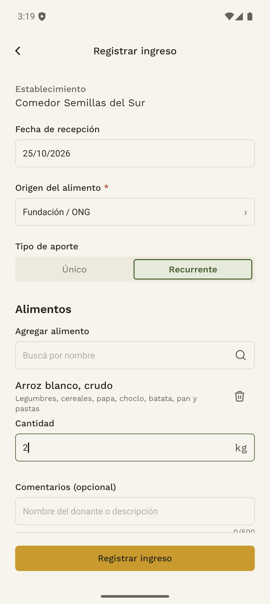

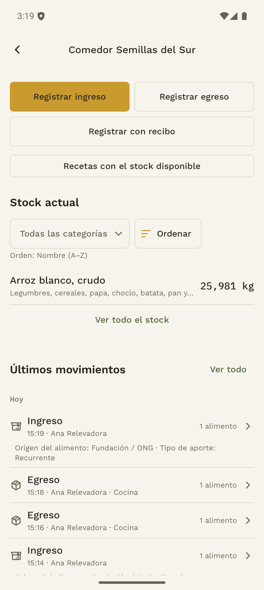

## 4.3 Registrar alimentos a partir de un recibo

**Dónde:** app → **Alimentos → Registrar con recibo**.

1. Elegí o tomá una foto legible del recibo. Incluí el documento completo y evitá reflejos o texto cortado.
2. Tocá **Procesar recibo** y esperá el análisis. Podés cancelar si necesitás volver.
3. Revisá la fecha propuesta, el origen, el tipo de aporte y cada línea de alimento.
4. Corregí la coincidencia del catálogo, la cantidad y la unidad cuando haga falta. El texto detectado del recibo se muestra como referencia.
5. Marcá cada línea como revisada y agregá o quitá alimentos para que el registro coincida con lo recibido.
6. Tocá **Guardar ingreso** y comprobá el movimiento registrado.

El análisis prepara una propuesta: **no registra automáticamente el ingreso**. La revisión es parte del trabajo. Si el análisis no está disponible, la opción **Cargar manualmente con esta foto** permite continuar la revisión manual cuando la pantalla la ofrece.

**Limitación comprobada en esta edición:** el análisis automático puede terminar en **No se pudo completar. Reintentá con este mismo recibo** por una incompatibilidad entre la app y el backend. Para continuar, elegí **Cargar manualmente con esta foto**, seleccioná los alimentos y completá las cantidades. Consultá al equipo antes de repetir el análisis indefinidamente.

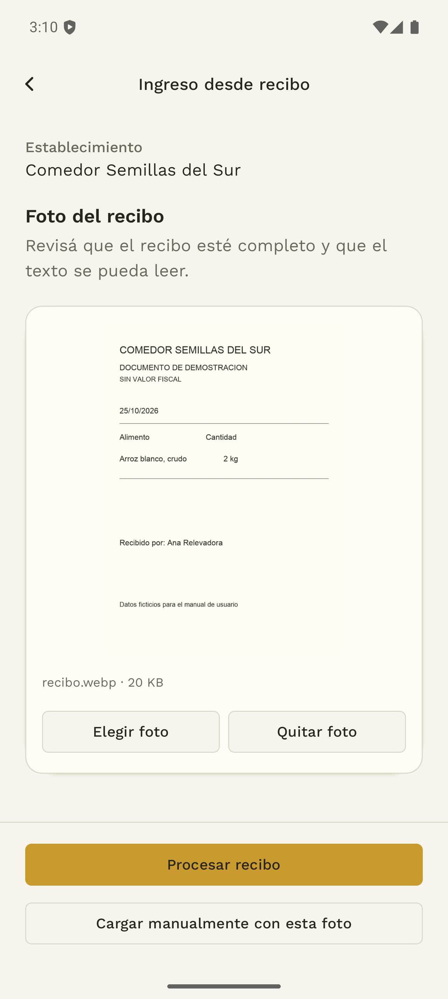

Si la imagen no es válida, resulta demasiado grande o no se puede procesar, elegí otra foto. Si falla el guardado, usá **Reintentar guardado** con ese mismo recibo después de revisar el estado. **Descartar recibo** elimina la preparación de esa carga; confirmalo solo si querés abandonar ese trabajo.

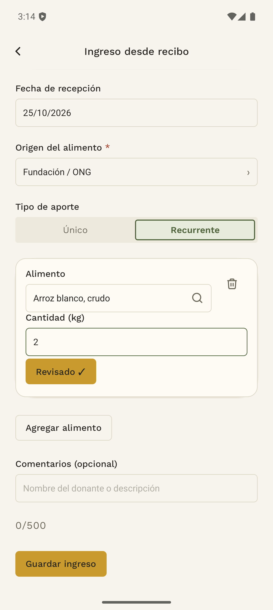

## 4.4 Registrar un egreso

**Dónde:** app → **Alimentos → Registrar egreso**.

1. Comprobá el comedor y completá la **Fecha del egreso**.
2. Indicá el **Destino del egreso**: entrega a familias, cocina, descarte u otro, según corresponda.
3. Seleccioná los alimentos desde el stock disponible; podés filtrar por categoría.
4. Ingresá las cantidades y agregá comentarios si hacen falta.
5. Tocá **Registrar egreso**.
6. Revisá el movimiento y el saldo restante en Stock.

No se puede retirar más de lo disponible. El stock puede cambiar mientras otra persona registra un movimiento: si el sistema informa existencias insuficientes, actualizá la consulta y ajustá las cantidades antes de volver a guardar.

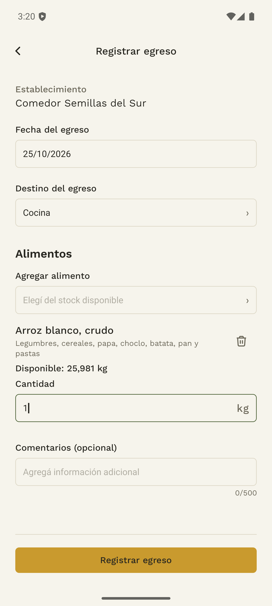

## 4.5 Registrar movimientos desde el backoffice

**Quién:** administrador o analista con acceso a las acciones correspondientes. **Dónde:** ficha del establecimiento → **Stock → Registrar movimiento**.

1. Elegí si se trata de un ingreso o un egreso.
2. Completá fecha, alimentos, cantidades y comentarios según el formulario.
3. Para un egreso, elegí también su destino. Para un ingreso, indicá el origen y si el aporte es único o recurrente.
4. Guardá y verificá **Movimiento registrado**.
5. Usá **Ver movimiento** o **Historial de Movimientos** para comprobar el registro.

Si se informa que el movimiento ya estaba registrado, abrí el guardado y revisalo antes de volver a cargarlo.

## 4.6 Consultar historial y detalle

En la app, abrí **Alimentos → Ver todo** en movimientos. En el backoffice, elegí **Stock → Historial de Movimientos**.

1. Filtrá por dirección del movimiento, fechas, alimento y las opciones disponibles.
2. Comprobá que la fecha inicial no sea posterior a la final.
3. Abrí un ingreso o egreso para revisar fecha, responsable, comentarios, alimentos, cantidades y unidad.
4. Si no encontrás un movimiento, quitá los filtros y comprobá el establecimiento.

No confundas **Historial** de tus cargas en la app con el historial completo de movimientos del comedor: pueden tener alcances diferentes.

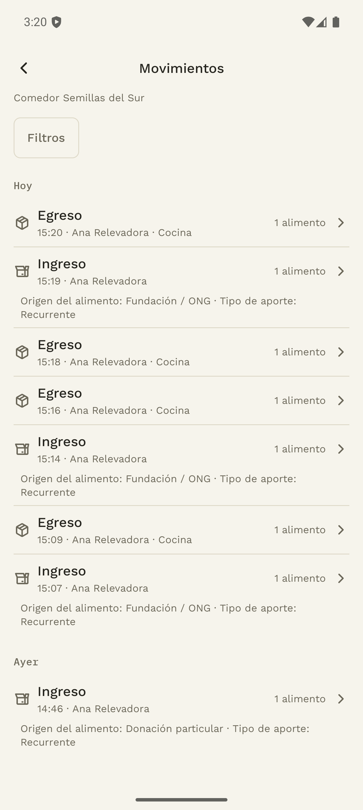

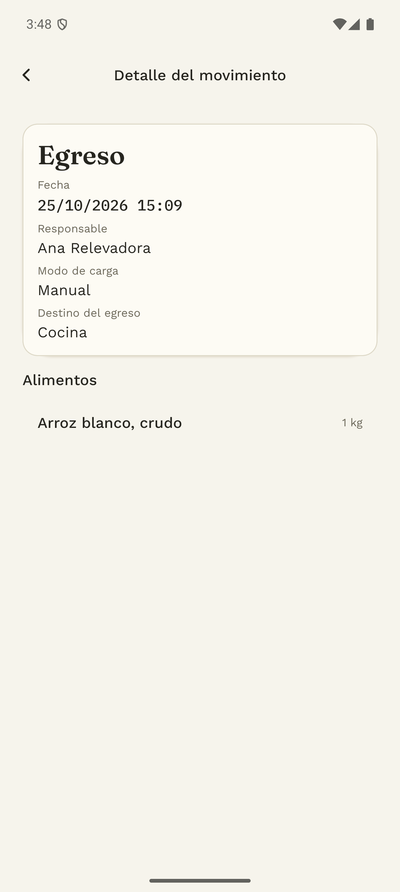

## 4.7 Solicitar propuestas de recetas

**Dónde:** app → Inicio → **Recetas**, o **Alimentos → Recetas con el stock disponible**.

1. Elegí el comedor y verificá sus existencias.
2. En **Generar**, completá **¿Cuántos chicos comen hoy?** con un número entero positivo.
3. Elegí el **Tipo de comida**: desayuno, almuerzo, merienda o cena.
4. Tocá **Buscar propuestas** y esperá. El formulario informa que la preparación puede tardar unos minutos.
5. Revisá las propuestas disponibles: nombre, porciones, ingredientes, cantidades, preparación y los indicadores y restricciones que se muestran.

Si no hay stock suficiente, el sistema no puede preparar una propuesta viable. Si la generación falla, revisá el mensaje y usá el reintento disponible. Una falta de conexión o un límite temporal no se resuelve creando repetidamente el mismo pedido.

Completar la ficha del establecimiento aporta contexto sobre la cocina y la comunidad. El formulario de recetas no pide inventar ingredientes que el comedor no tiene.

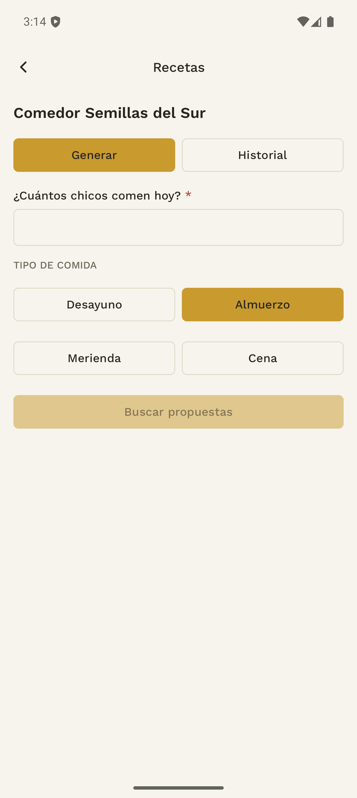

La propuesta puede advertir que no alcanza todos los objetivos. Abrí **Ver preparación y nutrientes** para revisar los pasos, indicadores y faltantes antes de decidir. El ejemplo de esta guía usa intencionalmente un stock limitado para mostrar ese aviso.

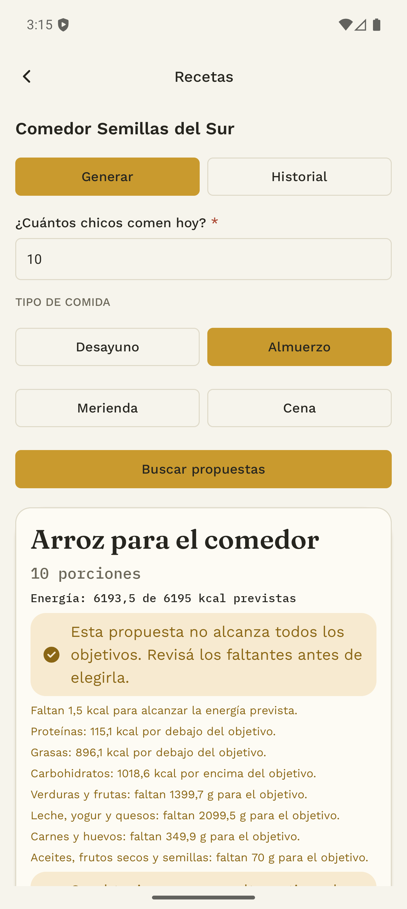

## 4.8 Elegir una receta y descontar sus ingredientes

1. En una propuesta, tocá **Elegir esta receta**.
2. Revisá el diálogo **¿Cocinar esta receta?**, el nombre y la cantidad de chicos.
3. Elegí **Confirmar y registrar salida** únicamente cuando quieras registrar ese consumo.
4. Comprobá la receta elegida, el egreso generado y el nuevo stock.

La confirmación crea una salida de alimentos y descuenta los ingredientes. Solo se puede elegir una propuesta por pedido. Si el stock cambió y no alcanza, revisá las existencias antes de continuar.

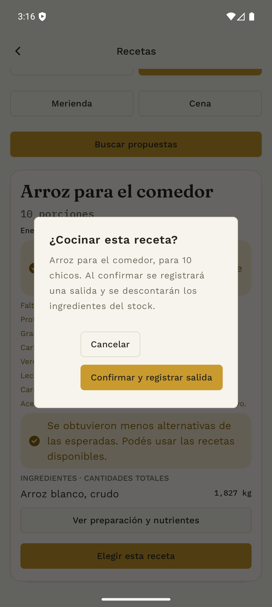

Si no se conoce el resultado por una falla de conexión, usá **Reintentar confirmación**. Si cambiaste de comedor, volvé al establecimiento indicado por la confirmación pendiente. Evitá registrar además un egreso manual por los mismos ingredientes.

## 4.9 Volver a cocinar una receta anterior

1. En **Recetas → Historial**, buscá una receta elegida y tocá **Ver receta**.
2. En **Volver a cocinar**, ingresá la **Cantidad de chicos de hoy**.
3. Tocá **Ver cantidades para hoy** para revisar los ingredientes ajustados.
4. Elegí **Cocinar esta receta**, revisá la confirmación y registrá la salida.
5. Comprobá el egreso y el stock actualizado.

La reutilización ajusta una receta existente y vuelve a validar las existencias actuales. Consultar el detalle o previsualizar cantidades todavía no registra un consumo.

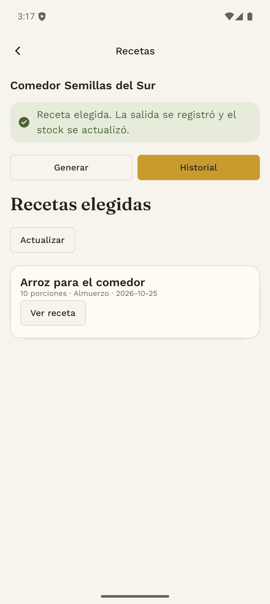

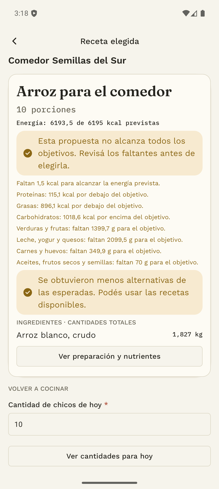

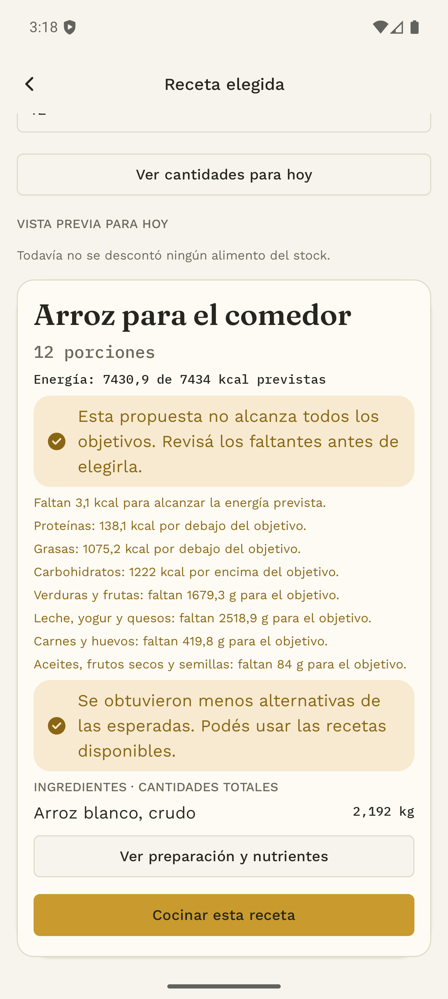

## 4.10 Resolver problemas sin duplicar movimientos

| Situación | Acción recomendada en la aplicación |
|---|---|
| No hay establecimiento elegido | Volvé a Inicio y seleccioná el comedor. |
| Sin conexión | Recuperá conectividad antes de registrar ingresos, egresos o confirmar recetas. |
| Ya no tenés acceso | Pedí a un administrador que revise el vínculo con el comedor. |
| Alimento no disponible en catálogo | Revisá la selección y elegí una entrada válida. |
| Stock insuficiente | Actualizá la consulta y ajustá el egreso o la receta. |
| Recibo con propuesta incorrecta | Corregí las líneas manualmente antes de confirmar. |
| Resultado de guardado incierto | Revisá Historial y usá el reintento del mismo formulario. |
| Servicio de recetas o recibos no disponible | Conservá los datos y seguí la alternativa manual disponible para el ingreso. |

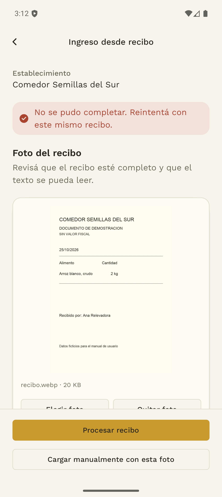

## 4.11 Recordatorios de actualización del stock

Android puede solicitar permiso para mostrar notificaciones después de iniciar sesión. Si lo permitís, podés recibir avisos cuando un establecimiento lleva tiempo sin registrar salidas.

Al abrir uno de esos avisos, la app selecciona el establecimiento indicado y abre su stock. Comprobá el comedor, revisá los últimos movimientos y registrá las salidas reales que correspondan. Abrir una notificación no crea un movimiento ni modifica las existencias.

Si no recibís avisos, podés consultar y actualizar la información desde **Alimentos**. La entrega de notificaciones no se verificó con el proveedor externo en esta edición.
