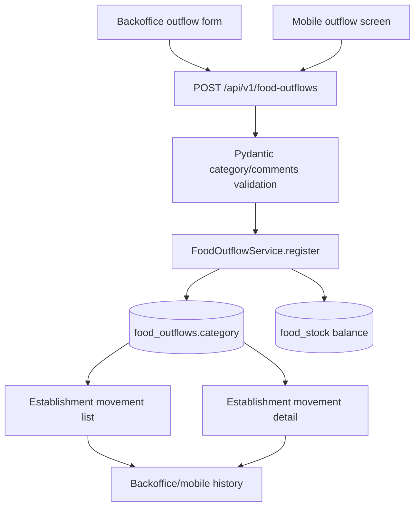

# Plan: Food Outflow Category

> **Feature:** Require people creating food outflows to select why stock left, and show that category in establishment history. [Backend #182](https://github.com/IngenieriaParaLaAlimentacion/backend/issues/182), [backoffice #88](https://github.com/IngenieriaParaLaAlimentacion/backoffice/issues/88), [mobile #83](https://github.com/IngenieriaParaLaAlimentacion/app_mobile/issues/83).
> **Date:** 2026-10-10
> **Based on research:** [research.md](research.md)
> **Repos:** backend, backoffice (`web`), app_mobile (`mobile`)
> **Worktree set:** `1-categoria-egresos-alimentos`, with paths in `.context/feature-worktrees/1-categoria-egresos-alimentos.tsv`

## 1. Overview & Objective

Each food outflow records one disposition: `family_delivery` (Entrega a familias), `kitchen` (Cocina), `discard` (Descarte), or `other` (Otro). Selecting Otro reveals an optional specification stored in the existing `comments` field. Selecting another category clears the text; sending the `comments` key with a non-`other` category returns 422, including when the value is null or empty. Existing outflows become `other` and retain their comments. The establishment movement list and detail show the category on outflows; intake rows expose a null category and remain visually unchanged. The mobile personal activity feed is outside the requested history scope.

Done means the migration, backend request/response contract, web form/history, and mobile form/history behave as above; current stock deduction, UUID replay, establishment access, and intake registration continue to work. The rollout has a temporary compatibility phase for installed mobile builds that omit category. A later backend enforcement PR fulfills the issue's final missing-category 422 criterion after those builds are out of support.

## 2. Architecture Decisions & Trade-offs

| Decision | Reason and consequence |
| --- | --- |
| Store an enum on `food_outflows` | The disposition belongs to the outflow header, distinct from food catalog category and the existing `source` loading method. |
| Reuse `comments` only for Otro | Matches all three issue contracts; no second text column or data copy is needed. The API rejects a present `comments` key for the other three categories. |
| Backfill old rows to `other` | No reliable historical classification exists. Preserve their text exactly. |
| Add category to establishment list and detail only | This is the user's chosen history scope. The list shows the label; detail shows the label and optional existing text. Personal activity and its mobile cache keep their current shape. |
| Send nullable category on mixed intake/outflow reads | A single response schema remains usable for both directions. An intake gets `category: null`; an outflow gets a non-null enum. |
| Accept omission as `other` temporarily | Installed mobile builds can continue posting after the backend deploy. Explicit null or invalid category still fails. A later backend PR removes the request default and adds the missing-field 422 assertion. |
| Keep the existing service and screen seams | No new endpoint, route, screen, permission, feature flag, or client fetch path is needed. |

The backend request validator runs before service registration and checks `model_fields_set` for the `comments` key. New clients omit that key entirely for non-`other` categories. The service copies the validated category to the outflow ORM header; existing ID replay returns the stored category without spending stock. Establishment history hydrates category from outflow headers after its existing pagination query.

## 3. Architecture Diagram



## 4. PR Plan & Landing Order

The feature worktrees are based on `origin/develop`. The backend's current branch is `feature/categor-a-obligatoria-egresos`; keep that name. The web and mobile worktrees are detached and should receive matching permitted branches, for example `feat/categoria-egresos-alimentos`. The repo workflow and backoffice CI target `develop` for feature PRs. Conductor currently names `origin/main` as this workspace's target, but backend `origin/main` is 280 commits behind this develop-based worktree and lacks the food movement module. Resolve that target/base mismatch before opening PRs; this plan creates no PR and recommends reviewing feature-only diffs against each repo's `origin/develop`.

| # | Repo | Planned branch / base | Contains | Safe to land alone? |
| --- | --- | --- | --- | --- |
| 1 | backend | current `feature/categor-a-obligatoria-egresos` → `develop` | Enum migration/backfill, temporary omitted-category fallback, validation, POST and establishment read categories, tests/OpenAPI | Yes. Old category-free clients map to `other`; added response fields are additive. Apply migration before app deployment. |
| 2 | backoffice | `feat/categoria-egresos-alimentos` → `develop` | Required outflow picker, conditional text, establishment list/detail labels | Yes after #1 is deployed everywhere. Current intake flow remains valid. |
| 3 | app_mobile | `feat/categoria-egresos-alimentos` → `develop` | Required outflow picker, conditional text serialization, establishment list/detail labels | Yes after #1 is deployed. Older installed builds remain usable through the fallback. #2 and #3 may land in either order after #1. |
| 4 | backend | `feature/categoria-egresos-strict` → `develop` | Remove temporary request default; missing category then returns 422, with tests and OpenAPI update | Only after the supported older mobile population and other writers no longer omit category. Merging the mobile PR alone does not establish that gate. |

Never release a new client to an old backend: the old Pydantic model can ignore its category and persist an outflow without the requested classification. No feature flag is required. The database default of `other` supports mixed application versions during the first deployment; the strict follow-up changes the HTTP request contract, and the stored column remains non-null.

## 5. Tasks Checklist

- [x] 1. Confirm one Alembic head and add the new enum/column migration with backfill and downgrade.
- [x] 2. Add the shared backend category enum and ORM mapping; update the outflow request validator, domain, service, and POST response.
- [x] 3. Hydrate and serialize category in establishment list/detail, retaining `null` for intakes and existing access checks.
- [ ] 4. Add backend request, migration, history, replay, and rollback checks; inspect generated OpenAPI. Deploy migration and backend.
- [ ] 5. Update backoffice types, form, copy, history views, mocks, and focused tests; deploy against the updated backend.
- [ ] 6. Update mobile domain/DTO/mapper, existing create screen and establishment history screens, and focused tests; release against the updated backend.
- [ ] 7. Verify an older installed mobile build still posts without category and its row appears as Otro; track supported-client adoption.
- [ ] 8. After the adoption gate, remove the backend request fallback in a separate PR and test missing-category 422.


## 6. DB Migrations and Data Access

### Migration

**New file:** `backend/alembic/versions/9f6c2a1b7e40_add_food_outflow_category.py`. A new revision is required; never edit `c8e3d5a91f74_add_food_outflow_and_stock_tables.py`. The revision ID is illustrative and should be checked for collision at implementation time.

The Alembic executable is absent from this worktree's Poetry environment (`env -u VIRTUAL_ENV /Users/juanduzac/.local/bin/poetry run alembic heads` returned `Command not found: alembic`). Parsing `revision`/`down_revision` across all 44 source migrations yielded exactly **one** head: `7d3e9a1b5c24` (`7d3e9a1b5c24_add_latest_per_subject_index_to_measurements.py`). After `poetry install --no-root`, run `poetry run alembic heads` and retain this parent only if it still reports one head. A concurrent revision requires rebasing this new migration (or an explicit merge revision).

```python
"""Add a disposition category to food outflows."""

from typing import Sequence, Union

import sqlalchemy as sa
from alembic import op
from sqlalchemy.dialects import postgresql

revision: str = "9f6c2a1b7e40"
down_revision: Union[str, Sequence[str], None] = "7d3e9a1b5c24"
branch_labels: Union[str, Sequence[str], None] = None
depends_on: Union[str, Sequence[str], None] = None

CATEGORY = postgresql.ENUM(
    "family_delivery", "kitchen", "discard", "other",
    name="foodoutflowcategory", create_type=False,
)

def upgrade() -> None:
    """Classify existing outflows as other and require a category on every row."""
    CATEGORY.create(op.get_bind(), checkfirst=True)
    op.add_column(
        "food_outflows", sa.Column("category", CATEGORY, nullable=True)
    )
    op.execute("UPDATE food_outflows SET category = 'other' WHERE category IS NULL")
    op.alter_column(
        "food_outflows", "category", existing_type=CATEGORY,
        nullable=False, server_default=sa.text("'other'::foodoutflowcategory"),
    )

def downgrade() -> None:
    """Remove the category column and its PostgreSQL enum."""
    op.drop_column("food_outflows", "category")
    CATEGORY.drop(op.get_bind(), checkfirst=True)
```

There is no new category index: registration writes a value by primary key; establishment list filtering and ordering still use the existing `(establishment_id, occurred_at)` indexes, and category is fetched for already paged IDs. No query filters or sorts by disposition. PostgreSQL backfills in the migration transaction; the explicit `UPDATE` preserves all comments and makes the legacy mapping inspectable. The server default protects the migration-first deployment window and other old direct writers. Check whether any writers bypass this table before removing it in a later release. Downgrade necessarily discards category data; take a backup before rollback in production.

### ORM model

**Modified:** `backend/app/models/food_outflows/food_outflow.py`. Import the shared `FoodOutflowCategory` enum from `app.domain.food_outflow` (defined in §7), and map the new column to the PostgreSQL enum name and database default. Keep the existing source mapping and comments.

```python
# BEFORE
from app.domain.food_outflow import FoodOutflowSource

    comments = Column(String, nullable=True)
    source = Column(
        SAEnum(FoodOutflowSource, values_callable=lambda x: [e.value for e in x]),
        nullable=False,
    )

# AFTER
from app.domain.food_outflow import FoodOutflowCategory, FoodOutflowSource

    comments = Column(String, nullable=True)
    category = Column(
        SAEnum(
            FoodOutflowCategory,
            values_callable=lambda x: [e.value for e in x],
            name="foodoutflowcategory",
        ),
        nullable=False,
        default=FoodOutflowCategory.OTHER,
        server_default="other",
    )
    source = Column(
        SAEnum(FoodOutflowSource, values_callable=lambda x: [e.value for e in x]),
        nullable=False,
    )
```

`default` supports existing Python-side creators/tests that instantiate `FoodOutflow` without a category during the transition; `server_default` matches the migration. Service code must still assign the explicit request category for new clients. `FoodOutflowDomain.from_db` and the service's `FoodOutflow(...)` construction are §7 changes.

### Repository reads

**Modified:** `backend/app/repositories/food_stock/food_stock_repository.py`. No new repository class is needed. The current two-stage listing fetches paged IDs from a union and then hydrates one direction at a time. Add the header category to that second query; intake rows project typed `None` so the result has one shape. Keep the union's three columns, avoiding mixed PostgreSQL enum types and preserving existing pagination/count logic.

```python
# BEFORE: _summaries_by_id, within select(...)
                User.last_name.label("responsible_last_name"),
                func.count(distinct(source.item_model.food_id)).label("food_count"),

# AFTER: _summaries_by_id, within select(...)
                User.last_name.label("responsible_last_name"),
                (
                    source.model.category
                    if direction == FoodMovementDirection.OUT
                    else literal(None, type_=source.model.comments.type)
                ).label("category"),
                func.count(distinct(source.item_model.food_id)).label("food_count"),
```

The full changed method retains its async signature, joins and grouping:

```python
async def _summaries_by_id(
    self, direction: FoodMovementDirection, movement_ids: list[UUID]
) -> dict[UUID, Row]:
    """Fetch responsible, category and distinct-food count for one direction."""
    if not movement_ids:
        return {}
    source = self._MOVEMENT_SOURCES[direction]
    category = (
        source.model.category
        if direction == FoodMovementDirection.OUT
        else literal(None, type_=source.model.comments.type)
    )
    result = await self.db.execute(
        select(
            source.model.id.label("id"),
            User.id.label("responsible_id"),
            User.name.label("responsible_name"),
            User.last_name.label("responsible_last_name"),
            category.label("category"),
            func.count(distinct(source.item_model.food_id)).label("food_count"),
        )
        .join(User, User.id == source.model.responsible_id)
        .outerjoin(source.item_model, source.item_fk == source.model.id)
        .where(source.model.id.in_(movement_ids))
        .group_by(source.model.id, User.id)
    )
    return {row.id: row for row in result.all()}
```

PostgreSQL permits selecting `category` while grouping by the table's primary key `source.model.id`; this relies on the existing query's `GROUP BY` pattern. If SQLAlchemy emits a query Postgres rejects, add the category expression to `group_by` only for the outflow branch. The §7 changes `FoodMovementSummaryDomain.from_rows` to read `summary_row.category`, and `FoodMovementDetailDomain.from_db` to read the loaded `FoodOutflow.category` only when direction is `out`.

**No change:** `FoodStockRepository.get_movement(...)` already selects the full header ORM row and eager loads its responsible and lines, so its `async def ... -> FoodMovementDetailDomain | None` signature and SQL stay unchanged. The domain projection makes category available in detail. Likewise `FoodOutflowRepository.get_by_id(outflow_id: UUID) -> FoodOutflow | None` selects the whole ORM row; POST/replay gets category without an added query. Neither repository should add a filter by category or change permissions.

## 7. API Changes (Backend)

### Backend files

#### Modify `app/domain/food_outflow.py`

Define the persisted category enum in the domain module so the ORM and Pydantic schemas share one vocabulary. Add it to the registration domain result and `from_db` projection.

```python
# BEFORE
class FoodOutflowSource(str, Enum):
    MANUAL = "manual"
    PHOTO = "photo"

@dataclass
class FoodOutflowDomain:
    comments: str | None
    source: FoodOutflowSource
    # ...
    @classmethod
    def from_db(cls, outflow):
        return cls(
            # ...
            comments=outflow.comments,
            source=outflow.source,
            # ...
        )

# AFTER (retain all existing fields and mappings)
class FoodOutflowCategory(str, Enum):
    """Why food left an establishment's stock."""

    FAMILY_DELIVERY = "family_delivery"
    KITCHEN = "kitchen"
    DISCARD = "discard"
    OTHER = "other"

@dataclass
class FoodOutflowDomain:
    comments: str | None
    category: FoodOutflowCategory
    source: FoodOutflowSource
    # ...
    @classmethod
    def from_db(cls, outflow):
        return cls(
            # ...
            comments=outflow.comments,
            category=outflow.category,
            source=outflow.source,
            # ...
        )
```

#### Modify `app/schemas/food_outflows/food_outflow_schema.py`

Request/response remain separate. The request default is the **temporary compatibility phase only**. Use `model_fields_set` to distinguish a missing `comments` key from a present `null` key. A model-level Pydantic `ValueError` uses the already registered canonical `/errors/validation-failed` 422 handler. No custom route or domain exception is needed.

```python
# BEFORE
from pydantic import BaseModel, ConfigDict, Field, field_validator
from app.domain.food_outflow import FoodOutflowSource

class FoodOutflowRequest(BaseModel):
    comments: str | None = Field(default=None, max_length=500)
    source: FoodOutflowSource = FoodOutflowSource.MANUAL
    # ...

class FoodOutflowResponse(BaseModel):
    comments: str | None
    source: FoodOutflowSource
    # ...

# AFTER (retain id, establishment_id, occurred_at, items, and date validator)
from pydantic import BaseModel, ConfigDict, Field, field_validator, model_validator
from app.domain.food_outflow import FoodOutflowCategory, FoodOutflowSource

class FoodOutflowRequest(BaseModel):
    comments: str | None = Field(
        default=None,
        max_length=500,
        description="Optional specification of category 'other'; omit for every other category.",
    )
    category: FoodOutflowCategory = Field(
        default=FoodOutflowCategory.OTHER,
        description="Why food left stock. Omission temporarily maps legacy clients to 'other'.",
    )
    source: FoodOutflowSource = FoodOutflowSource.MANUAL
    # ...

    @model_validator(mode="after")
    def comments_only_for_other(self) -> "FoodOutflowRequest":
        """Accept comments only when the outflow category is other."""
        if (
            self.category != FoodOutflowCategory.OTHER
            and "comments" in self.model_fields_set
        ):
            raise ValueError("comments may be supplied only for category 'other'")
        return self

class FoodOutflowResponse(BaseModel):
    comments: str | None
    category: FoodOutflowCategory
    source: FoodOutflowSource
    # ...
```

The `comments` field remains optional and max 500 characters for `other`. Do not require nonblank specification; the user said "allow specification." Retain the current source and date validation. `model_fields_set` is important: testing `self.comments is not None` would incorrectly accept a present null key on a non-`other` category.

#### Modify `app/services/food_outflows/food_outflow_service.py`

Keep the existing ID replay branch before establishment and stock work. Copy the validated effective category into the new ORM field for a new outflow. `FoodOutflowDomain.from_db` returns the stored category for ordinary creation, pre-read replay, and concurrent insert replay. Do not compare replay payloads or modify existing rows: current idempotency is keyed only by ID.

```python
# BEFORE
if data.id is not None:
    existing = await self.uow.food_outflow_repo.get_by_id(data.id)
    if existing is not None:
        return FoodOutflowDomain.from_db(existing), False
# ...
outflow = FoodOutflow(
    id=data.id,
    establishment_id=data.establishment_id,
    responsible_id=actor.user_id,
    occurred_at=data.occurred_at,
    comments=data.comments,
    source=data.source,
)

# AFTER
if data.id is not None:
    existing = await self.uow.food_outflow_repo.get_by_id(data.id)
    if existing is not None:
        return FoodOutflowDomain.from_db(existing), False
# ...
outflow = FoodOutflow(
    id=data.id,
    establishment_id=data.establishment_id,
    responsible_id=actor.user_id,
    occurred_at=data.occurred_at,
    comments=data.comments,
    category=data.category,
    source=data.source,
)
```

The existing `UniqueConstraintError` race handler and conditional stock decrement remain in place. Schema validation runs before this service, so an invalid category or forbidden comments yields 422 without touching stock. A valid category can still yield the existing `/errors/insufficient-stock` 409 with no persisted header, lines, or balance change.

#### Modify `app/domain/food_stock.py`

Add category to the two distinct establishment read models. The data lane changes `_summaries_by_id` to select `source.model.category` for outflows and SQL `NULL` for intakes under the same `category` label; it keeps the paginated union's three shared columns unchanged. The detail row already loads the header ORM instance, so no new query is needed.

```python
# BEFORE
class FoodMovementSummaryDomain:
    id: UUID
    direction: FoodMovementDirection
    occurred_at: datetime
    responsible: ResponsibleRefDomain
    food_count: int
    # from_rows(...): food_count=summary_row.food_count,

class FoodMovementDetailDomain:
    comments: str | None
    source: str
    # from_db(...): comments=movement.comments, source=movement.source,

# AFTER (keep every existing field)
from app.domain.food_outflow import FoodOutflowCategory

class FoodMovementSummaryDomain:
    category: FoodOutflowCategory | None
    # from_rows(...): category=summary_row.category,

class FoodMovementDetailDomain:
    category: FoodOutflowCategory | None
    # from_db(...):
    # category=movement.category if direction == FoodMovementDirection.OUT else None,
```

If the repository expresses intake null as `literal(None).label("category")`, group/select that column consistently in its per-direction summary query. Do **not** add category to the `UNION ALL` of intake/outflow pagination: the outflow enum and intake null can cause unnecessary SQL type coercion, and the summary hydration already has the header table in hand.

#### Modify `app/schemas/food_stock/food_stock_schema.py`

Serialize the mixed-direction category as an always-present nullable key in both establishment response shapes. This is additive for existing JSON clients and unambiguous for new clients.

```python
# BEFORE
from app.domain.food_intake import FoodIntakeSource
from app.domain.food_stock import FoodMovementDirection

class FoodMovementSummary(BaseModel):
    id: UUID
    direction: FoodMovementDirection
    occurred_at: datetime
    responsible: ResponsibleRefResponse
    food_count: int

class FoodMovementDetail(BaseModel):
    id: UUID
    direction: FoodMovementDirection
    occurred_at: datetime
    source: FoodIntakeSource
    comments: str | None
    responsible: ResponsibleRefResponse
    items: list[FoodLineResponse]

# AFTER (retain existing fields and ConfigDict)
from app.domain.food_outflow import FoodOutflowCategory

class FoodMovementSummary(BaseModel):
    # existing fields ...
    category: FoodOutflowCategory | None

class FoodMovementDetail(BaseModel):
    # existing fields ...
    category: FoodOutflowCategory | None
```

Avoid a schema default of `None`; the projection must explicitly provide the key so an outflow omission cannot silently render as intake-like `null`.

#### Modify `app/api/v1/food_outflows.py`

The route body stays thin and its `response_model` already applies the expanded response schema. Extend only the OpenAPI description and 422 response metadata; the handler implementation and `require_any` dependency remain as they are.

```python
# BEFORE
description=(
    "Records an outflow and subtracts every line from the establishment's "
    "stock, in one transaction. ..."
),
responses={status.HTTP_200_OK: {...}, **AUTH_RESPONSES, ...},

# AFTER (keep existing stock/replay/404/409 text and response entries)
description=(
    "Records an outflow and subtracts every line from the establishment's "
    "stock, in one transaction. ...\n\n"
    "`category` is family_delivery, kitchen, discard, or other. `comments` "
    "may be supplied only with other; omit the key for all other values. "
    "Omitting category temporarily records other for older clients."
),
responses={
    status.HTTP_200_OK: {...},
    **AUTH_RESPONSES,
    status.HTTP_422_UNPROCESSABLE_CONTENT: {
        "description": "Invalid category or comments supplied for a non-other category"
    },
    # existing 404 and 409 ...
},
```

#### Modify `app/api/v1/establishments/stock.py`

Only adjust route descriptions; handlers continue to call `FoodStockService`, which already centralizes establishment lookup and access checking. Document category on list and detail, and null for intakes.

```python
# BEFORE
description=(
    "Intakes and outflows merged into a single sequence, newest first, one "
    "entry per movement. ..."
),
# detail: "... plus the movement's source and comments. ..."

# AFTER (retain existing filtering and scoping wording)
description=(
    "Intakes and outflows merged into a single sequence, newest first, one "
    "entry per movement. Outflows include their disposition category; "
    "intakes have null category. ..."
),
# detail: "... plus source, comments, and the outflow category (null for intakes). ..."
```

`docs/generate_openapi.py` produces the backend OpenAPI schema from the app; there is no checked-in backend JSON to hand-edit. Verify generated request/response schemas and route descriptions after implementation. Do not touch personal activity schemas, repository, or route. No new exception class, `app/main.py` change, permission rule, or config setting is needed.

### Tests

#### New `tests/unit/food/test_food_outflow_schema.py`

Purpose: lock the compatibility default, exact `comments` key-presence rule, valid enum values, and eventual strict gate. The following is a complete illustrative phase-one test file; use the existing time/quantity conventions and freeze dates as needed.

```python
import uuid
from datetime import datetime, timezone

import pytest
from pydantic import ValidationError

from app.domain.food_outflow import FoodOutflowCategory
from app.schemas.food_outflows.food_outflow_schema import FoodOutflowRequest

def _body(**overrides):
    return {
        "establishment_id": uuid.uuid4(),
        "occurred_at": datetime(2026, 9, 1, tzinfo=timezone.utc),
        "items": [{"food_id": uuid.uuid4(), "quantity": "1"}],
        **overrides,
    }

@pytest.mark.parametrize(
    "category",
    ["family_delivery", "kitchen", "discard", "other"],
)
def test_accepts_each_category(category):
    assert FoodOutflowRequest.model_validate(_body(category=category)).category == category

def test_missing_category_temporarily_means_other():
    request = FoodOutflowRequest.model_validate(_body(comments="Legacy detail"))
    assert request.category is FoodOutflowCategory.OTHER
    assert request.comments == "Legacy detail"

@pytest.mark.parametrize("comments", [None, "", "unexpected"])
def test_non_other_rejects_any_present_comments_key(comments):
    with pytest.raises(ValidationError):
        FoodOutflowRequest.model_validate(
            _body(category="kitchen", comments=comments)
        )

def test_non_other_accepts_omitted_comments_key():
    request = FoodOutflowRequest.model_validate(_body(category="discard"))
    assert request.comments is None

@pytest.mark.parametrize("category", [None, "unknown"])
def test_rejects_invalid_category(category):
    with pytest.raises(ValidationError):
        FoodOutflowRequest.model_validate(_body(category=category))

def test_other_allows_optional_comments():
    assert FoodOutflowRequest.model_validate(
        _body(category="other", comments="Community event")
    ).comments == "Community event"
```

#### Modify `tests/unit/food/test_food_stock_services.py`

Keep existing intake tests unchanged. Make the outflow helper explicit for new requests, and set a stored outflow fixture category so the new `from_db` mapping is meaningful. Add a service assertion that creation passes the category to `FoodOutflow` and a replay assertion that it returns the stored category and does not spend stock, even if the retry has a different category (the established ID-only replay semantics).

```python
# BEFORE
def _outflow_request(**overrides):
    return FoodOutflowRequest(..., source=FoodOutflowSource.MANUAL, **overrides)

# AFTER
def _outflow_request(**overrides):
    return FoodOutflowRequest(
        ...,
        category=FoodOutflowCategory.KITCHEN,
        source=FoodOutflowSource.MANUAL,
        **overrides,
    )

# Add assertions in TestRegisterOutflow:
# created: inspect uow.food_outflow_repo.create.await_args.args[0].category
# replay: stored category OTHER returned in FoodOutflowDomain;
#         decrease_many/create/commit are not awaited.
```

If overriding `category` in a helper call, merge defaults in a dict first to avoid duplicate keyword arguments. Use an explicit `make_stored(category=...)` value for outflows; the shared intake fixture can retain its current source.

#### Modify `tests/integration/food/stock/helpers.py`

Default `_outflow_body` to a new-client request with category `other`. Individual tests can override the category; a dedicated legacy test removes the key. This prevents unrelated integration tests from exercising only the compatibility path.

```python
# BEFORE
body = {
    "establishment_id": str(establishment_id),
    "occurred_at": "2026-09-02T10:00:00Z",
    "items": [...],
}

# AFTER
body = {
    "establishment_id": str(establishment_id),
    "occurred_at": "2026-09-02T10:00:00Z",
    "category": "other",
    "items": [...],
}
```

#### Modify `tests/integration/food/stock/test_register.py`

Add authenticated POST cases: each of four categories persists and returns in 201; an omitted category records/returns `other` while preserving legacy comments; non-`other` with omitted comments works; non-`other` with comments key as `null` or text returns canonical 422 and spends no stock; invalid/null category returns 422; `other` with optional comments works; replay of a previous ID returns stored category in 200 and leaves stock unchanged. Keep the existing repeated-line 409 and all-or-nothing tests, now with an explicit category from the helper. Add a 409 assertion that no category-bearing outflow row persists, alongside the existing count check. Use the existing field worker fixture and seeded intake balance.

```python
# BEFORE
response = await client.post(
    OUTFLOWS_URL,
    json=_outflow_body(db_establishment.id, [(foods.rice, "4")]),
    headers=headers,
)
assert response.status_code == 201

# AFTER (representative new assertions)
response = await client.post(
    OUTFLOWS_URL,
    json=_outflow_body(
        db_establishment.id, [(foods.rice, "4")], category="kitchen"
    ),
    headers=headers,
)
assert response.status_code == 201
assert response.json()["category"] == "kitchen"
# For a forbidden key, assert status 422, type /errors/validation-failed,
# unchanged _balance(...), and no new FoodOutflow row.
```

#### Modify `tests/integration/food/stock/test_movements.py`

Update the existing exact-key assertions for summary and detail to include `category`. Check `None` on both intake shapes and an explicit non-`other` value on both outflow shapes. Keep pagination, ordering, food count, field-worker scoping, and cross-establishment 404 cases to catch a category projection that bypasses authorization. The existing outflow detail test with `comments="Almuerzo"` must use `category="other"`; a new kitchen detail case must omit comments.

```python
# BEFORE
assert set(item) == {"id", "direction", "occurred_at", "responsible", "food_count"}
assert set(body) == {"id", "direction", "occurred_at", "source", "comments", "responsible", "items"}

# AFTER
assert set(item) == {"id", "direction", "occurred_at", "responsible", "food_count", "category"}
assert item["category"] is None  # intake
assert set(body) == {"id", "direction", "occurred_at", "source", "comments", "responsible", "items", "category"}
assert body["category"] is None  # intake
# For an outflow posted as kitchen: list row and detail both say "kitchen".
```

#### OpenAPI and integration verification

Run `env -u VIRTUAL_ENV poetry run pytest tests/unit/food/test_food_outflow_schema.py tests/unit/food/test_food_stock_services.py`, then Docker-backed `env -u VIRTUAL_ENV poetry run pytest tests/integration/food/stock/test_register.py tests/integration/food/stock/test_movements.py`, and full backend gates (`env -u VIRTUAL_ENV poetry run pre-commit run --all-files`, `env -u VIRTUAL_ENV poetry run pytest`). Fresh worktrees may need `poetry install --no-root`; Poetry may live at `/Users/juanduzac/.local/bin/poetry`. Generate or inspect OpenAPI through the app's existing `docs/generate_openapi.py` workflow and confirm all four enum values, temporary request default, required non-null POST response category, and nullable establishment read category. The cross-field `comments` rule is enforced at runtime and described in the endpoint text; OpenAPI's ordinary field schema cannot express the present-key condition without a custom one-of request schema.

### Strict-contract follow-up

After the client rollout and a defined support/adoption gate confirms category-free mobile builds are no longer supported, make a separate backend PR. In `app/schemas/food_outflows/food_outflow_schema.py`, change `category: FoodOutflowCategory = Field(default=FoodOutflowCategory.OTHER, ...)` to `category: FoodOutflowCategory = Field(description="Why food left stock")`. Remove the omission-compatibility sentence from `app/api/v1/food_outflows.py`, update the unit legacy-default test into a missing-category 422 test, and add an integration missing-category 422 assertion. Keep existing rows as `other`; do not rewrite history. No DB migration is needed for that follow-up because the column is already non-null. A strict release while old mobile builds are still supported would break their POST requests, so the follow-up gate is a release dependency, not a timer.

## 8. Web Changes (Backoffice)

### Contract and dependencies

- The web implementation depends on the backend migration and deployed API contract. `POST /api/v1/food-outflows` accepts `category: "family_delivery" | "kitchen" | "discard" | "other"`; `comments` is the existing optional specification for `other`. For every non-`other` outflow the client omits the `comments` key entirely; sending it, even as `null`, gets 422. The outflow response and both establishment movement reads add `category` for outflows. Intake rows have `category: null`. Existing outflows backfill to `other` with their original `comments` untouched. The `source` field continues to mean entry method.
- `GET /api/v1/establishments/{id}/food-movements` must return category per summary row; `GET /api/v1/establishments/{id}/food-movements/{movement_id}` must return category and existing comments. Category is visible in the list (desktop table and mobile-sized cards) and detail. Optional `other` text appears in detail where comments already render. The caller's personal activity history is outside this feature.
- Backend deploys first and temporarily treats a missing outflow category from older clients as `other`. This web client always sends category for new outflows. No permission or feature flag changes: existing authenticated access and establishment scoping remain.
- The web repo's `docs/architecture.md` explicitly uses `useState`/`useEffect` hooks for ordinary data reads and reserves SWR for the establishments map. Existing `useEstablishmentMovementsHistory` and `getEstablishmentFoodMovementAction` already use the authorized dispatcher and require no new fetch hook or endpoint constant. `useCreateFoodMovement` freezes the complete body on ambiguous failures and also requires no change. Keep the new category inside that frozen body.
- Design follows `components/ui/` primitives and the Raíz tokens. The catalog-food category picker in `MovementFoodPicker` remains a separate concept.

No new production files are necessary. The existing form, type, copy, history, service and mock files are the correct seams. No new route or API service is needed.

### Modified files

#### `web/types/establishment.ts`

Purpose: share the backend enum with the form and history; express the intake/outflow distinction without requiring category on intake POSTs. The backend returns `category: null` for intake history rows; outflow response category is included for the POST. Before:

```ts
export type FoodMovementDirection = "in" | "out";
export type FoodMovementListItem = {
  id: string;
  direction: FoodMovementDirection;
  occurred_at: string;
  responsible: FoodMovementResponsible;
  food_count: number;
};
export type FoodMovementDetail = {
  id: string;
  direction: FoodMovementDirection;
  occurred_at: string;
  source: FoodMovementSource;
  comments: string | null;
  responsible: FoodMovementResponsible;
  items: FoodMovementItem[];
};
export type CreateFoodMovementRequest = {
  id: string;
  establishment_id: string;
  occurred_at: string;
  comments: string | null;
  source: "manual";
  items: { food_id: string; quantity: string }[];
};
```

After (retain the existing comments/docs and unrelated fields):

```ts
export type FoodMovementDirection = "in" | "out";
export type FoodOutflowCategory =
  | "family_delivery"
  | "kitchen"
  | "discard"
  | "other";

export type FoodMovementListItem = {
  id: string;
  direction: FoodMovementDirection;
  occurred_at: string;
  responsible: FoodMovementResponsible;
  food_count: number;
  category: FoodOutflowCategory | null;
};

export type FoodMovementDetail = {
  id: string;
  direction: FoodMovementDirection;
  occurred_at: string;
  source: FoodMovementSource;
  comments: string | null;
  category: FoodOutflowCategory | null;
  responsible: FoodMovementResponsible;
  items: FoodMovementItem[];
};

type FoodMovementRequestBase = {
  id: string;
  establishment_id: string;
  occurred_at: string;
  source: "manual";
  items: { food_id: string; quantity: string }[];
};
export type CreateFoodIntakeRequest = FoodMovementRequestBase & {
  comments: string | null;
};
export type CreateFoodOutflowRequest = FoodMovementRequestBase & (
  | { category: "other"; comments?: string | null }
  | { category: Exclude<FoodOutflowCategory, "other">; comments?: never }
);
export type CreateFoodMovementRequest =
  | CreateFoodIntakeRequest
  | CreateFoodOutflowRequest;

export type CreatedFoodMovement = {
  // existing fields...
  category?: FoodOutflowCategory; // only outflow POST responses
};
```

Keep `CreatedFoodMovement`'s existing complete fields, adding only `category?`; the abbreviated comment above is not a replacement for them. At the call site, explicitly branch on direction and construct `CreateFoodOutflowRequest` for outflow, `CreateFoodIntakeRequest` for intake. Avoid spreading an outflow-only property into intake. The service's existing `CreateFoodMovementRequest` union accepts either and sends it unmodified.

#### `web/constants/establishments.ts`

Purpose: one typed option list and label map for the four exact Spanish choices; centralize form/history copy. Before:

```ts
export const MOVEMENT_DIRECTION_LABELS: Record<FoodMovementDirection, string> = {
  in: "Ingreso",
  out: "Egreso",
};
export const ESTABLISHMENT_MOVEMENTS_PAGE = {
  // ...
  columns: { date: "Fecha", direction: "Dirección", responsible: "Responsable", foods: "Alimentos" },
  detail: { title: "Detalle del movimiento", direction: "Dirección", comments: "Comentarios" },
} as const;
export const FOOD_MOVEMENT_FORM = {
  // ...
  comments: "Comentarios",
} as const;
```

After:

```ts
import type { FoodOutflowCategory } from "@/types/establishment";

export const FOOD_OUTFLOW_CATEGORY_OPTIONS: {
  value: FoodOutflowCategory;
  label: string;
}[] = [
  { value: "family_delivery", label: "Entrega a familias" },
  { value: "kitchen", label: "Cocina" },
  { value: "discard", label: "Descarte" },
  { value: "other", label: "Otro" },
];
export const FOOD_OUTFLOW_CATEGORY_LABELS: Record<FoodOutflowCategory, string> = {
  family_delivery: "Entrega a familias",
  kitchen: "Cocina",
  discard: "Descarte",
  other: "Otro",
};

export const ESTABLISHMENT_MOVEMENTS_PAGE = {
  // existing keys...
  columns: {
    date: "Fecha",
    direction: "Dirección",
    category: "Categoría del egreso",
    responsible: "Responsable",
    foods: "Alimentos",
  },
  detail: {
    // existing keys...
    category: "Categoría del egreso",
  },
} as const;

export const FOOD_MOVEMENT_FORM = {
  // existing keys...
  category: "Categoría del egreso",
  chooseCategory: "Elegí una categoría",
  categoryRequired: "Elegí una categoría para el egreso",
  otherSpecification: "Especificación (opcional)",
  otherSpecificationHint: "Contá qué pasó con los alimentos, si querés.",
  comments: "Comentarios", // intake remains unchanged
} as const;
```

Preserve all existing keys when adding these. The form's `otherSpecification` uses the backend's existing `comments` field and 500-character limit.

#### `web/schemas/foodMovement.schema.ts`

Purpose: require a category for outflows in browser validation, leave intake alone, and keep optional Other text within the existing comments bound. Before:

```ts
export const foodMovementSchema = z.object({
  direction: z.enum(["in", "out"]),
  date: z.iso.date({ error: FOOD_MOVEMENT_FORM.invalidDate }),
  comments: z.string().max(500, "Máximo 500 caracteres"),
  lines: z.array(foodMovementLineSchema).min(1, "Agregá un alimento"),
});
```

After:

```ts
export const foodMovementSchema = z
  .object({
    direction: z.enum(["in", "out"]),
    date: z.iso.date({ error: FOOD_MOVEMENT_FORM.invalidDate }),
    category: z.union([
      z.literal(""),
      z.enum(["family_delivery", "kitchen", "discard", "other"]),
    ]),
    comments: z.string().max(500, "Máximo 500 caracteres"),
    lines: z.array(foodMovementLineSchema).min(1, "Agregá un alimento"),
  })
  .superRefine((value, ctx) => {
    if (value.direction === "out" && value.category === "") {
      ctx.addIssue({
        code: "custom",
        path: ["category"],
        message: FOOD_MOVEMENT_FORM.categoryRequired,
      });
    }
  });
```

`validateMovement` keeps its stock, date and food checks. The UI resets `comments` immediately on `other` → another category and on intake/outflow direction switches; submission omits the `comments` key for non-Other outflow as a safety net. The schema's category `""` is an unselected form state, never an API value.

#### `web/components/FoodMovementDialog.tsx`

Purpose: show required outflow-category select, show optional text only for Other, clear hidden text, and post the correct body. Reuse `Input`, existing `SELECT_CLASS`, form error style, and theme classes. Do not add a new independent comment field. Before:

```tsx
const initial = (direction: FoodMovementDirection): FoodMovementInput => ({
  direction,
  date: argentineToday(),
  comments: "",
  lines: [{ food: null, quantity: "" }],
});
// ...
const body = {
  id: entryId,
  establishment_id: establishmentId,
  occurred_at: value.date === today ? new Date().toISOString() : argentineDayStartUtc(value.date)!,
  comments: value.comments.trim() || null,
  source: "manual" as const,
  items: value.lines.map((line) => ({ food_id: selectedFoodId(line.food!), quantity: apiQuantity(line.quantity) })),
};
const saved = await save.submit(direction, body);
// ...
<label className="text-sm">
  {COPY.comments}
  <textarea ... {...register("comments")} />
</label>
```

After (integrate into the surrounding existing component):

```tsx
import {
  FOOD_OUTFLOW_CATEGORY_OPTIONS,
  SELECT_CLASS,
  // existing imports...
} from "@/constants/establishments";
import type {
  CreateFoodIntakeRequest,
  CreateFoodOutflowRequest,
  FoodOutflowCategory,
} from "@/types/establishment";

const initial = (direction: FoodMovementDirection): FoodMovementInput => ({
  direction,
  date: argentineToday(),
  category: "",
  comments: "",
  lines: [{ food: null, quantity: "" }],
});

// In component, alongside the existing direction watch:
const category = watch("category");

// In submit, after existing validateMovement and before save.submit:
const base = {
  id: entryId,
  establishment_id: establishmentId,
  occurred_at:
    value.date === today
      ? new Date().toISOString()
      : argentineDayStartUtc(value.date)!,
  source: "manual" as const,
  items: value.lines.map((line) => ({
    food_id: selectedFoodId(line.food!),
    quantity: apiQuantity(line.quantity),
  })),
};
const body: CreateFoodIntakeRequest | CreateFoodOutflowRequest =
  direction === "out"
    ? value.category === "other"
      ? { ...base, category: "other", comments: value.comments.trim() || null }
      : {
          ...base,
          category: value.category as Exclude<FoodOutflowCategory, "other">,
          // No comments property. Backend rejects it for non-Other, even null.
        }
    : { ...base, comments: value.comments.trim() || null };
const saved = await save.submit(direction, body);

// Place after date and before food lines, only in outflow mode:
{direction === "out" && (
  <div className="flex flex-col gap-1 text-sm">
    <label htmlFor="outflow-category">{COPY.category}</label>
    <select
      id="outflow-category"
      className={SELECT_CLASS}
      disabled={locked}
      value={category}
      onChange={(event) => {
        const next = event.target.value as FoodMovementInput["category"];
        if (category === "other" && next !== "other") {
          setValue("comments", "", { shouldValidate: true });
          clearErrors("comments");
        }
        setValue("category", next, { shouldValidate: true });
        clearErrors("category");
      }}
    >
      <option value="">{COPY.chooseCategory}</option>
      {FOOD_OUTFLOW_CATEGORY_OPTIONS.map(({ value, label }) => (
        <option key={value} value={value}>{label}</option>
      ))}
    </select>
    {errors.category && <p role="alert" className={ERROR_CLASS}>{errors.category.message}</p>}
  </div>
)}

// Replace the current unconditional comments field with:
{(direction === "in" || category === "other") && (
  <label className="text-sm">
    {direction === "in" ? COPY.comments : COPY.otherSpecification}
    <textarea
      className="w-full rounded-lg border border-input bg-background p-2"
      disabled={locked}
      {...register("comments")}
    />
    {direction === "out" && (
      <small className="text-muted-foreground">{COPY.otherSpecificationHint}</small>
    )}
  </label>
)}
{errors.comments && <p role="alert" className={ERROR_CLASS}>{errors.comments.message}</p>}
```

`startDraft(next)` already calls `reset(initial(next))`, so changing direction clears the category and comments. Keep `locked` on the select/textarea: retrying a frozen ambiguous write must resend identical `category` and `comments` with the same ID. The `save.submit` service/hook do not need a new call path.

#### `web/app/dashboard/establishments/[id]/stock/movements/page.tsx`

Purpose: display outflow category in desktop list and mobile-sized cards, with no category cell text for intake. The existing history hook and service need no changes because their typed response passes rows through. Before:

```tsx
<th className="px-4 py-3 font-medium">{columns.direction}</th>
<th className="px-4 py-3 font-medium">{columns.responsible}</th>
// ...
<td className="px-4 py-3">{MOVEMENT_DIRECTION_LABELS[movement.direction]}</td>
<td className="px-4 py-3 text-muted-foreground">{movement.responsible.name} ...</td>
// card:
<span className="text-sm font-medium">{MOVEMENT_DIRECTION_LABELS[movement.direction]}</span>
```

After:

```tsx
import { FOOD_OUTFLOW_CATEGORY_LABELS } from "@/constants/establishments";

<th className="px-4 py-3 font-medium">{columns.direction}</th>
<th className="px-4 py-3 font-medium">{columns.category}</th>
<th className="px-4 py-3 font-medium">{columns.responsible}</th>
// ...
<td className="px-4 py-3">{MOVEMENT_DIRECTION_LABELS[movement.direction]}</td>
<td className="px-4 py-3 text-muted-foreground">
  {movement.direction === "out" && movement.category
    ? FOOD_OUTFLOW_CATEGORY_LABELS[movement.category]
    : ""}
</td>
<td className="px-4 py-3 text-muted-foreground">{movement.responsible.name} ...</td>
// card, inside the metadata flex group:
{movement.direction === "out" && movement.category && (
  <span>{FOOD_OUTFLOW_CATEGORY_LABELS[movement.category]}</span>
)}
```

Retain the existing responsive table/card affordances and row click handlers. `other` details are available by opening the existing panel; summary API does not carry comments.

#### `web/app/dashboard/establishments/[id]/stock/movements/MovementDetailPanel.tsx`

Purpose: show outflow category next to direction/date/responsible; the existing comments field then shows optional Other specification and old-row comments. Before:

```tsx
{detail.direction === "in" && (
  <DetailField label={COPY.detail.source} value={MOVEMENT_SOURCE_LABELS[detail.source]} />
)}
// ...
{detail.comments && (
  <DetailField label={COPY.detail.comments} value={<span className="block whitespace-pre-line break-words">{detail.comments}</span>} />
)}
```

After:

```tsx
import { FOOD_OUTFLOW_CATEGORY_LABELS } from "@/constants/establishments";

{detail.direction === "in" && (
  <DetailField label={COPY.detail.source} value={MOVEMENT_SOURCE_LABELS[detail.source]} />
)}
{detail.direction === "out" && detail.category && (
  <DetailField
    label={COPY.detail.category}
    value={FOOD_OUTFLOW_CATEGORY_LABELS[detail.category]}
  />
)}
// ...
{detail.comments && (
  <DetailField
    label={COPY.detail.comments}
    value={<span className="block whitespace-pre-line break-words">{detail.comments}</span>}
  />
)}
```

Preserve the existing comments label for legacy records and intake; do not pretend an old free-text comment was typed into the new Other control. In the detail of a newly created Other outflow it is the optional specification. Escaping is React text rendering, not `dangerouslySetInnerHTML`.

#### `web/mocks/handlers/foodMovement.ts`

Purpose: keep MSW as a backend-shaped preview and test boundary. Before:

```ts
const body = (await request.json()) as CreateFoodMovementRequest;
const existing = createdMovement(body.id);
if (existing) return HttpResponse.json(existing, { status: 200 });
// ...
const movement: CreatedFoodMovement = { id: body.id, /* existing fields */, items };
currentMovements(body.establishment_id).push({ id: movement.id, direction, occurred_at: movement.occurred_at, responsible: RESPONSIBLE, food_count: items.length });
MOCK_FOOD_MOVEMENT_DETAILS[movement.id] = { id: movement.id, direction, occurred_at: movement.occurred_at, source: "manual", comments: movement.comments, responsible: RESPONSIBLE, items };
```

After:

```ts
const body = (await request.json()) as CreateFoodMovementRequest;
const existing = createdMovement(body.id);
if (existing) return HttpResponse.json(existing, { status: 200 });
// Before stock mutation, mirror the backend's transitional omission and validation:
const category =
  direction === "out" && "category" in body ? body.category : "other";
if (
  direction === "out" &&
  !(["family_delivery", "kitchen", "discard", "other"] as string[]).includes(category)
) return problem("validation-failed", "Validation failed", 422, path);
if (direction === "out" && category !== "other" && "comments" in body)
  return problem("validation-failed", "Validation failed", 422, path);
// ... existing food and stock validation and mutation ...
const movement: CreatedFoodMovement = {
  id: body.id,
  // all existing fields...
  comments: body.comments ?? null,
  ...(direction === "out" ? { category } : {}),
  items,
};
currentMovements(body.establishment_id).push({
  id: movement.id,
  direction,
  occurred_at: movement.occurred_at,
  responsible: RESPONSIBLE,
  food_count: items.length,
  category: direction === "out" ? category : null,
});
MOCK_FOOD_MOVEMENT_DETAILS[movement.id] = {
  id: movement.id,
  direction,
  occurred_at: movement.occurred_at,
  source: "manual",
  comments: movement.comments,
  category: direction === "out" ? category : null,
  responsible: RESPONSIBLE,
  items,
};
```

Use a narrowed `CreateFoodOutflowRequest` or a local typed category helper to satisfy TypeScript; the snippet describes the flow. `path` is already defined in this handler, so place validation after that declaration. Keep replay lookup before validation exactly as backend does; an existing ID returns the stored record without re-spending stock.

#### `web/mocks/fixtures/establishment.ts`

Purpose: make established outflow rows display `Otro`, other category variants, and no category on intakes. Before:

```ts
{ id: MOVEMENT_IDS.outflow, direction: "out", occurred_at: "2026-09-12T13:00:00Z", responsible: RESPONSIBLE, food_count: 1 }
// detail:
{ id: MOVEMENT_IDS.outflow, direction: "out", source: "manual", comments: "Almuerzo", /* ... */ }
// paged fixture:
{ id: /* ... */, direction: index % 2 === 0 ? "in" : "out", /* ... */, food_count: 1 }
```

After:

```ts
{ id: MOVEMENT_IDS.outflow, direction: "out", occurred_at: "2026-09-12T13:00:00Z", responsible: RESPONSIBLE, food_count: 1, category: "other" }
// all intake list fixtures: category: null
// outflow detail:
{ id: MOVEMENT_IDS.outflow, direction: "out", source: "manual", comments: "Almuerzo", category: "other", /* ... */ }
// paged list fixture:
{
  id: /* ... */,
  direction: index % 2 === 0 ? "in" : "out",
  category: index % 2 === 0 ? null : "kitchen",
  /* ... */
}
// paged detail fixture spreads the row, so category carries through.
```

Keep all existing fixture fields/line arrays, and the `baseDetails` clone/reset behavior. The default old outflow's `Almuerzo` comment demonstrates backfill preservation; paged fixtures exercise a second label.

#### `web/schemas/foodMovement.schema.test.ts`

Before: tests cover dates, duplicate foods, stock and unit quantities, with no category field in form values. After: add `category: ""` to existing intake values and `category: "kitchen"` to outflow values; add cases:

```ts
expect(foodMovementSchema.safeParse({ direction: "out", category: "", date, comments: "", lines }).error?.issues)
  .toEqual(expect.arrayContaining([expect.objectContaining({ path: ["category"], message: FOOD_MOVEMENT_FORM.categoryRequired })]));
expect(foodMovementSchema.safeParse({ direction: "in", category: "", date, comments: "", lines }).success)
  .toBe(true);
expect(foodMovementSchema.safeParse({ direction: "out", category: "other", date, comments: "", lines }).success)
  .toBe(true);
```

Define valid `date` and `lines` in the test, import the copy constant. Also check 501-character optional specification is rejected by the existing bound.

#### `web/components/FoodMovementDialog.test.tsx`

Before: intake/outflow tests submit without choosing an outflow disposition; retries assert an unchanged body. After: select a category in every valid outflow test and verify both request shape and UI rules. Representative additions:

```tsx
await user.click(screen.getByLabelText("Egreso"));
await user.selectOptions(screen.getByLabelText("Categoría del egreso"), "other");
expect(screen.getByLabelText("Especificación (opcional)")).toBeInTheDocument();
await user.type(screen.getByLabelText("Especificación (opcional)"), "Para taller");
await user.selectOptions(screen.getByLabelText("Categoría del egreso"), "kitchen");
expect(screen.queryByLabelText("Especificación (opcional)")).not.toBeInTheDocument();
// After completing food/date and submitting, POST body has category: "kitchen",
// no comments key at all; never "Para taller".
```

Also assert unselected category blocks POST and gives the Spanish field error; `other` accepts empty specification; intake keeps its Comments control and request has no `category`; a 422 keeps the selected category/lines; ambiguous retry resends exactly the same ID, category, and comments. Preserve the existing stock conflict and 200/201 replay coverage.

#### `web/services/foodMovement.service.test.ts`

Before: one intake-shaped `body` is used for both `in` and `out` in `it.each`. After: use separate typed bodies, with outflow category:

```ts
const intakeBody: CreateFoodIntakeRequest = { /* existing body */ };
const outflowBody: CreateFoodOutflowRequest = { ...intakeBody, category: "family_delivery" };
it.each([
  ["in", FOOD_INTAKES_ENDPOINT, intakeBody, 201, false],
  ["out", FOOD_OUTFLOWS_ENDPOINT, outflowBody, 200, true],
] as const)("posts %s and preserves replay", async (direction, endpoint, body, status, replayed) => {
  // existing dispatcher assertion, now verifies exact category-bearing body
});
```

#### `web/app/dashboard/establishments/[id]/stock/movements/page.test.tsx`

Before: list/detail assertions cover direction, dates, food count, comments and filters, but no outflow category. After: assert the seeded old outflow row/card renders `Otro`, intake rows contain no category label, and the outflow detail renders `Categoría del egreso` → `Otro` with its preserved `Almuerzo` comment. Test `Cocina` via the paged fixture or a new outflow and confirm the label appears in both desktop and responsive card paths. Use the existing route test harness and MSW fixtures; avoid testing implementation details of the history hook.

## 9. Mobile Changes

### Contract and dependency

The mobile implementation depends on the backend PR and its deployed migration/API. `POST /api/v1/food-outflows` accepts `category` with the wire values `family_delivery`, `kitchen`, `discard`, `other`; it continues to accept an omitted category from installed old builds as `other` during the compatibility window. A new build must always send a category. `comments` is an optional specification for `other` only; omit the key for other categories because the backend rejects it with 422. The establishment summary and detail GETs add nullable `category` (`null` for intakes; category for outflows). No category is added to personal activity. Existing `source` and food catalog category are distinct fields. All established role and establishment access checks stay in the backend.

The existing create-outflow, establishment-history, and establishment-detail screens already each have the Action / Destination / Navigation / Screen / State / ViewModel pattern, and their routes, nav host, Koin bindings, repository interfaces, and use cases are already registered. This feature changes those screens in place: **no new screen, route, navigation entry, DI registration, repository interface, use case, or API client is needed**. The existing repository implementation sends the updated DTO through its mapper, and the existing establishment repository maps the updated GET DTOs. Personal history and its serialized SQLite cache model remain unchanged, so old cached rows deserialize with their original schema and no migration is needed.

### New file: domain category

**`composeApp/src/commonMain/kotlin/ar/com/ingenieriaalimentacion/domain/model/food/FoodOutflowCategory.kt`** — keep the backend wire value and Spanish display label together, separate from `FoodCategory` (catalog classification). Full illustrative implementation:

```kotlin
package ar.com.ingenieriaalimentacion.domain.model.food

enum class FoodOutflowCategory(val wireValue: String, val label: String) {
    FamilyDelivery("family_delivery", "Entrega a familias"),
    Kitchen("kitchen", "Cocina"),
    Discard("discard", "Descarte"),
    Other("other", "Otro");

    companion object {
        fun fromWireValue(value: String?): FoodOutflowCategory? =
            entries.firstOrNull { it.wireValue == value }
    }
}
```

Unknown or absent values on a historical GET map to `null` and are left unlabeled; they must not be falsely described as `Otro`. The backend backfill makes existing outflows `other`; the nullable mapping also allows a client pointed at an older environment to show the rest of a movement.

### Request model and mapping

**`composeApp/src/commonMain/kotlin/ar/com/ingenieriaalimentacion/domain/model/food/NewFoodOutflow.kt`** — require the disposition in the domain command. Before:

```kotlin
val occurredAtEpochMillis: Long,
val comments: String?,
val items: List<NewFoodOutflowLine>,
```

After:

```kotlin
val occurredAtEpochMillis: Long,
val category: FoodOutflowCategory,
val comments: String?,
val items: List<NewFoodOutflowLine>,
```

**`composeApp/src/commonMain/kotlin/ar/com/ingenieriaalimentacion/data/food/dto/FoodOutflowRequest.kt`** — serialize the required category and omit default `null` comments despite global `Json.encodeDefaults = true` (`@EncodeDefault(NEVER)` is already used by other project DTOs). Before:

```kotlin
val comments: String? = null,
val source: String = MANUAL_SOURCE,
```

After (add the import `kotlinx.serialization.EncodeDefault`):

```kotlin
val category: String,
@EncodeDefault(EncodeDefault.Mode.NEVER)
val comments: String? = null,
val source: String = MANUAL_SOURCE,
```

**`composeApp/src/commonMain/kotlin/ar/com/ingenieriaalimentacion/data/food/mapper/FoodOutflowMapper.kt`** — send comments only for `other`. Before:

```kotlin
occurredAt = occurredAtIso,
comments = comments?.takeIf(String::isNotBlank),
items = items.map { FoodLineRequest(foodId = it.foodId, quantity = it.quantity) },
```

After (import `FoodOutflowCategory`):

```kotlin
occurredAt = occurredAtIso,
category = category.wireValue,
comments = if (category == FoodOutflowCategory.Other) {
    comments?.trim()?.takeIf(String::isNotBlank)
} else null,
items = items.map { FoodLineRequest(foodId = it.foodId, quantity = it.quantity) },
```

The mapper is a second guard against a stale comments value escaping after category changes. The request has the existing stable `id` on retry; successful 200 replay remains success.

### Create screen: reuse six-file feature

**`composeApp/src/commonMain/kotlin/ar/com/ingenieriaalimentacion/presentation/feature/food/create_food_outflow/CreateFoodOutflowState.kt`** — add required choice, picker visibility, and non-text-field validation. Name these `outflowCategory` to avoid conflating them with `stock.selectedCategoryId`. Before:

```kotlin
val occurredAt: TextFieldState = TextFieldState(),
val comments: TextFieldState = TextFieldState(),
val lines: List<FoodOutflowLine> = emptyList(),
```

After (import `FoodOutflowCategory`):

```kotlin
val occurredAt: TextFieldState = TextFieldState(),
val outflowCategory: FoodOutflowCategory? = null,
val outflowCategoryError: String? = null,
val showOutflowCategoryPicker: Boolean = false,
val comments: TextFieldState = TextFieldState(),
val lines: List<FoodOutflowLine> = emptyList(),
```

Keep `canSubmit` as an online/loading/establishment/line gate, so tapping submit with no category shows its required error rather than silently disabling the button. `MAX_OUTFLOW_COMMENTS = 500` remains the API field limit.

**`composeApp/src/commonMain/kotlin/ar/com/ingenieriaalimentacion/presentation/feature/food/create_food_outflow/CreateFoodOutflowAction.kt`** — add destination actions alongside the existing catalog picker actions. Before:

```kotlin
data class CommentsFocusChanged(val focused: Boolean) : CreateFoodOutflowAction
data object StockPickerOpen : CreateFoodOutflowAction
```

After (import `FoodOutflowCategory`):

```kotlin
data class CommentsFocusChanged(val focused: Boolean) : CreateFoodOutflowAction
data object OutflowCategoryPickerOpen : CreateFoodOutflowAction
data object OutflowCategoryPickerDismiss : CreateFoodOutflowAction
data class OutflowCategorySelected(val category: FoodOutflowCategory) : CreateFoodOutflowAction
data object StockPickerOpen : CreateFoodOutflowAction
```

**`composeApp/src/commonMain/kotlin/ar/com/ingenieriaalimentacion/presentation/feature/food/create_food_outflow/CreateFoodOutflowViewModel.kt`** — reduce the new actions, clear optional specification when moving away from `other`, and require category before calling the use case. Before (part of `onAction`):

```kotlin
is CreateFoodOutflowAction.CommentsFocusChanged -> _state.update {
    it.copy(comments = it.comments.onFocus(action.focused, commentsValidator))
}
CreateFoodOutflowAction.StockPickerOpen -> {
```

After (import `FoodOutflowCategory`):

```kotlin
is CreateFoodOutflowAction.CommentsFocusChanged -> _state.update {
    it.copy(comments = it.comments.onFocus(action.focused, commentsValidator))
}
CreateFoodOutflowAction.OutflowCategoryPickerOpen ->
    _state.update { it.copy(showOutflowCategoryPicker = true) }
CreateFoodOutflowAction.OutflowCategoryPickerDismiss ->
    _state.update { it.copy(showOutflowCategoryPicker = false) }
is CreateFoodOutflowAction.OutflowCategorySelected -> _state.update { current ->
    current.copy(
        outflowCategory = action.category,
        outflowCategoryError = null,
        showOutflowCategoryPicker = false,
        comments = if (action.category == FoodOutflowCategory.Other) {
            current.comments
        } else {
            TextFieldState()
        },
    )
}
CreateFoodOutflowAction.StockPickerOpen -> {
```

Before (`submit()` validation and domain construction):

```kotlin
comments = current.comments.showError(commentsValidator),
lines = current.lines.map { it.copy(quantity = it.quantity.showError(validatorFor(it))) },
// ...
if (!state.occurredAt.isValid || !state.comments.isValid ||
    state.lines.isEmpty() || state.lines.any { !it.quantity.isValid }
) return null
return NewFoodOutflow(
    id = state.outflowId,
    establishmentId = establishment.id,
    occurredAtEpochMillis = occurredAtMillis(date),
    comments = state.comments.value.trim().takeIf(String::isNotBlank),
```

After:

```kotlin
outflowCategoryError = if (current.outflowCategory == null) "Elegí el destino del egreso." else null,
comments = if (current.outflowCategory == FoodOutflowCategory.Other) {
    current.comments.showError(commentsValidator)
} else current.comments,
lines = current.lines.map { it.copy(quantity = it.quantity.showError(validatorFor(it))) },
// ...
val category = state.outflowCategory ?: return null
if (!state.occurredAt.isValid ||
    (category == FoodOutflowCategory.Other && !state.comments.isValid) ||
    state.lines.isEmpty() || state.lines.any { !it.quantity.isValid }
) return null
return NewFoodOutflow(
    id = state.outflowId,
    establishmentId = establishment.id,
    occurredAtEpochMillis = occurredAtMillis(date),
    category = category,
    comments = state.comments.value.trim().takeIf(String::isNotBlank)
        .takeIf { category == FoodOutflowCategory.Other },
```

The date, quantity, connectivity, 409 stock refresh, 422 error handling, and UUID retry paths remain in their present methods. On a failed request the chosen category and `other` specification stay in state.

**`composeApp/src/commonMain/kotlin/ar/com/ingenieriaalimentacion/presentation/feature/food/create_food_outflow/CreateFoodOutflowScreen.kt`** — add a labeled disposition selector to the form and use the existing `AlBottomSheet` + `FoodSelectionOption` pattern for four options. Show the optional text field only for `Other`. Use `AlSelectField`, `AlInput`, `AlTheme` spacing/colors/type, and no new icons or tokens. Before, the form has only the food-line block then an always-visible comments field:

```kotlin
Column(verticalArrangement = Arrangement.spacedBy(AlTheme.spacing.xs)) {
    AlInput(label = "Comentarios (opcional)", value = state.comments.value, ...)
    Text(text = state.commentsCount, ...)
}
```

After, immediately after the date field and before the food-line block:

```kotlin
AlSelectField(
    label = "Destino del egreso",
    value = state.outflowCategory?.label.orEmpty(),
    placeholder = "Elegí una opción",
    enabled = enabled,
    onClick = { onAction(CreateFoodOutflowAction.OutflowCategoryPickerOpen) },
)
state.outflowCategoryError?.let { error ->
    Text(error, style = AlTheme.typography.caption, color = AlTheme.colors.danger)
}
```

After, replace the always-visible comments block with:

```kotlin
if (state.outflowCategory == FoodOutflowCategory.Other) {
    Column(verticalArrangement = Arrangement.spacedBy(AlTheme.spacing.xs)) {
        AlInput(
            label = "Especificá otro destino (opcional)",
            value = state.comments.value,
            onValueChange = { onAction(CreateFoodOutflowAction.CommentsChanged(it)) },
            onFocusChange = { onAction(CreateFoodOutflowAction.CommentsFocusChanged(it)) },
            error = state.comments.displayError,
            enabled = enabled,
            singleLine = false,
            placeholder = "Agregá información adicional",
            scrollState = scrollState,
            isImeVisible = isImeVisible,
        )
        Text(
            text = state.commentsCount,
            modifier = Modifier.fillMaxWidth(),
            textAlign = TextAlign.End,
            style = AlTheme.typography.caption,
            color = AlTheme.colors.textMuted,
        )
    }
}
```

Before, the scaffold overlays only the stock and catalog-category sheets:

```kotlin
if (state.stock.showPicker) StockSheet(state, onAction)
if (state.stock.showCategoryPicker) CategorySheet(state, onAction)
```

After (add import `FoodOutflowCategory`):

```kotlin
if (state.stock.showPicker) StockSheet(state, onAction)
if (state.stock.showCategoryPicker) CategorySheet(state, onAction)
if (state.showOutflowCategoryPicker) OutflowCategorySheet(state, onAction)
```

Add this private composable to the same screen file (it is a modification, not a new screen):

```kotlin
@OptIn(ExperimentalMaterial3Api::class)
@Composable
private fun OutflowCategorySheet(
    state: CreateFoodOutflowState,
    onAction: (CreateFoodOutflowAction) -> Unit,
) {
    AlBottomSheet(
        onDismissRequest = { onAction(CreateFoodOutflowAction.OutflowCategoryPickerDismiss) },
    ) {
        Column(
            modifier = Modifier.navigationBarsPadding()
                .heightIn(max = 480.dp)
                .verticalScroll(rememberScrollState())
                .selectableGroup(),
        ) {
            Text(
                "Destino del egreso",
                style = AlTheme.typography.subtitle,
                color = AlTheme.colors.textBase,
                modifier = Modifier.padding(AlTheme.spacing.md),
            )
            FoodOutflowCategory.entries.forEach { category ->
                FoodSelectionOption(
                    title = category.label,
                    selected = state.outflowCategory == category,
                    onClick = { onAction(CreateFoodOutflowAction.OutflowCategorySelected(category)) },
                )
            }
        }
    }
}
```

The existing stock sheet's `Categoría` label remains a filter for foods. The new `Destino del egreso` label makes the distinction explicit.

### Establishment history read path

**`composeApp/src/commonMain/kotlin/ar/com/ingenieriaalimentacion/data/food/dto/EstablishmentFoodMovementDto.kt`** — allow the additive field and older environments. Before summary/detail tails:

```kotlin
@SerialName("food_count") val foodCount: Int,
// detail:
val comments: String? = null,
val responsible: ResponsibleRefDto,
```

After:

```kotlin
@SerialName("food_count") val foodCount: Int,
val category: String? = null,
// detail:
val comments: String? = null,
val responsible: ResponsibleRefDto,
val items: List<EstablishmentFoodMovementLineDto>,
val category: String? = null,
```

Keep new constructor fields at the end to avoid changing positional test constructors; Kotlin serialization uses field names on the wire.

**`composeApp/src/commonMain/kotlin/ar/com/ingenieriaalimentacion/domain/model/food/EstablishmentFoodMovement.kt`** — carry disposition only in establishment summary/detail. Before:

```kotlin
val responsible: ResponsibleRef,
val foodCount: Int,
// detail:
val comments: String?,
val responsible: ResponsibleRef,
```

After, add defaulted fields at the end of each model to preserve positional test fixtures:

```kotlin
// EstablishmentFoodMovementSummary, after foodCount:
val category: FoodOutflowCategory? = null,
// EstablishmentFoodMovementDetail, after items:
val category: FoodOutflowCategory? = null,
```

**`composeApp/src/commonMain/kotlin/ar/com/ingenieriaalimentacion/data/food/mapper/EstablishmentFoodMovementMapper.kt`** — map only outflow categories. Before:

```kotlin
foodCount = foodCount,
// detail:
comments = comments,
responsible = responsible.toDomain(),
```

After (import `FoodOutflowCategory`):

```kotlin
foodCount = foodCount,
category = if (direction == "out") FoodOutflowCategory.fromWireValue(category) else null,
// detail:
comments = comments,
category = if (direction == "out") FoodOutflowCategory.fromWireValue(category) else null,
responsible = responsible.toDomain(),
```

**`composeApp/src/commonMain/kotlin/ar/com/ingenieriaalimentacion/presentation/feature/food/establishment_food_movement_history/EstablishmentFoodMovementHistoryScreen.kt`** — show the category in each outflow list row, without changing intake rows or adding filters. Before:

```kotlin
subtitle = "${formatMovementTime(item.occurredAtMillis)} · ${item.responsible.fullName}",
```

After:

```kotlin
subtitle = buildList {
    add(formatMovementTime(item.occurredAtMillis))
    add(item.responsible.fullName)
    if (item.direction == EstablishmentFoodMovementDirection.Out) {
        item.category?.label?.let(::add)
    }
}.joinToString(" · "),
```

**`composeApp/src/commonMain/kotlin/ar/com/ingenieriaalimentacion/presentation/feature/food/establishment_food_movement_detail/EstablishmentFoodMovementDetailScreen.kt`** — show a disposition fact for outflows above optional comments, retaining the existing origin (`manual`/`photo`) fact. Before:

```kotlin
DetailFact("Origen", if (detail.source == FoodMovementSource.Photo) "Foto" else "Manual")
detail.comments?.takeIf { it.isNotBlank() }?.let {
    DetailFact("Comentarios", it)
}
```

After:

```kotlin
DetailFact("Origen", if (detail.source == FoodMovementSource.Photo) "Foto" else "Manual")
if (detail.direction == EstablishmentFoodMovementDirection.Out) {
    detail.category?.let { DetailFact("Destino del egreso", it.label) }
}
detail.comments?.takeIf { it.isNotBlank() }?.let {
    DetailFact("Comentarios", it)
}
```

The fact displays legacy `other` comments after migration. The list has no comments in its API shape; do not manufacture the optional specification there. No change to `FoodMovementActivityDto`, `FoodMovement`, `FoodMovementHistoryRepositoryImpl`, or personal-history UI.

### Test modifications

Use current `commonTest` fixtures and Kotlin `kotlin.test`; these are behavior checks for the changed contract rather than snapshots of implementation details.

**`composeApp/src/commonTest/kotlin/ar/com/ingenieriaalimentacion/data/food/mapper/FoodOutflowMapperTest.kt`** — before the only fixture omitted category and expected blank comments removed:

```kotlin
comments = "  ",
// ...
assertNull(request.comments)
```

After, include `category = FoodOutflowCategory.Other`, assert `request.category == "other"`, trim nonblank optional specification, and add a `Kitchen` case with a stale comment whose mapped `comments` is null. Import the new enum. Illustrative assertions:

```kotlin
assertEquals("other", otherRequest.category)
assertEquals("Comedor barrial", otherRequest.comments)
assertEquals("kitchen", kitchenRequest.category)
assertNull(kitchenRequest.comments)
```

**`composeApp/src/commonTest/kotlin/ar/com/ingenieriaalimentacion/data/food/FoodOutflowApiTest.kt`** — before fixture had comments without category and the body test checked only date/quantity:

```kotlin
comments = "Almuerzo",
items = listOf(FoodLineRequest("food-1", "4.000")),
// ...
assertTrue(encoded.contains("\"quantity\":4.000"))
```

After, make base fixture `category = "other"`; assert JSON has `"category":"other"` and comments. Add a `request.copy(category = "kitchen", comments = null)` call through the MockEngine configured with `encodeDefaults = true`, and assert the captured body lacks the `comments` key entirely. Keep existing 200/201 and 422 mapping checks.

**`composeApp/src/commonTest/kotlin/ar/com/ingenieriaalimentacion/presentation/feature/food/create_food_outflow/CreateFoodOutflowViewModelTest.kt`** — before `submitValid()` selected food and quantity then submitted, and the success case sent comments regardless of disposition:

```kotlin
fixture.viewModel.onAction(CreateFoodOutflowAction.FoodPicked(arroz))
fixture.viewModel.onAction(CreateFoodOutflowAction.LineQuantityChanged(arroz.foodId, quantity))
fixture.viewModel.onAction(CreateFoodOutflowAction.Submit)
```

After, select `FoodOutflowCategory.FamilyDelivery` in the shared helper before submit. The former comment success case selects `Other` before changing comments; assert its created command has `Other` and the text. Add tests that submitting food/quantity without category shows the selection error and calls no repository, selecting each category records its enum, switching from `Other` to `Kitchen` clears comments, and a failed retry preserves ID/category/specification. For the shared helper:

```kotlin
fixture.viewModel.onAction(
    CreateFoodOutflowAction.OutflowCategorySelected(FoodOutflowCategory.FamilyDelivery),
)
fixture.viewModel.onAction(CreateFoodOutflowAction.FoodPicked(arroz))
fixture.viewModel.onAction(CreateFoodOutflowAction.LineQuantityChanged(arroz.foodId, quantity))
fixture.viewModel.onAction(CreateFoodOutflowAction.Submit)
```

**`composeApp/src/commonTest/kotlin/ar/com/ingenieriaalimentacion/data/food/mapper/EstablishmentFoodMovementMapperTest.kt`** — before a summary fixture had no category and detail mapped comments/source but no disposition:

```kotlin
private fun summary(direction: String = "in", occurredAt: String = "...") =
    EstablishmentFoodMovementSummaryDto("m1", direction, occurredAt, responsible, 3)
assertNull(detail.comments)
```

After, add outflow summary and detail DTO fixtures carrying `category = "family_delivery"` and `"other"`, assert enum mapping, assert intake category remains null even if sent, and assert unknown/missing response categories map to null. This also covers the old API compatibility default. Example:

```kotlin
assertEquals(FoodOutflowCategory.FamilyDelivery, outSummary.toDomain().category)
assertEquals(FoodOutflowCategory.Other, outDetail.toDomain().category)
assertNull(intakeWithCategory.toDomain().category)
assertNull(summary(direction = "out").toDomain().category)
```

**`composeApp/src/commonTest/kotlin/ar/com/ingenieriaalimentacion/data/food/EstablishmentFoodMovementApiTest.kt`** — before JSON fixtures omitted category and decoding assertions covered comments/lines:

```kotlin
private val pageJson = """{"items":[{"id":"m1","direction":"in",...}]}"""
assertEquals("Donación", detail.comments)
```

After, keep an intake fixture with `"category":null`, add outflow summary/detail response fixtures containing `"category":"discard"` and `"category":"other"`, and assert decoded category values. Keep one old response fixture with no category to assert default null. Exact endpoint/error tests stay unchanged. Example:

```kotlin
assertEquals("discard", outPage.items.single().category)
assertEquals("other", outDetail.category)
assertNull(oldDetail.category)
```

## 10. Cross-cutting Changes

### Authorization and error behavior

- `POST /api/v1/food-outflows` and both establishment movement GETs already use `require_any`. Current authenticated admin, superadmin, analyst, and field-worker roles remain allowed. Field-worker establishment scoping stays in `app/services/access.py::check_establishment_access`, called by the existing services. Do not introduce middleware, route-level permission logic, role changes, or configuration/feature flags.
- Pydantic enum/type validation and the cross-field key-presence validator feed the existing `RequestValidationError` handler in `app/exceptions/exception_handlers.py`: HTTP 422, `application/problem+json`, `type: /errors/validation-failed`, and generic `detail`. No new error type or global handler is needed. Invalid category and forbidden comments do not write an outflow or spend stock. Do not interpret the generic error text as a field-specific UI message; local client form validation should identify the category or text rule in Spanish while preserving the draft after server errors.
- The existing `InsufficientStockError` remains HTTP 409 `/errors/insufficient-stock` with its `food_id`, `requested`, and `available` extensions. The request's category is not an authorization signal and must not alter stock deduction, rollback, or replay behavior.

### OpenAPI and file ownership

**No additional cross-cutting files or code changes are needed.** The following existing files are changed in §§6–9:

| Repo and path | Owner | Cross-cutting requirement |
| --- | --- | --- |
| `backend/app/schemas/food_outflows/food_outflow_schema.py` | API-backend | Enum in request/response, temporary omission default, `model_fields_set` rule, field description documenting optional `comments` only for `other`. |
| `backend/app/api/v1/food_outflows.py` | API-backend | Extend operation description and 422 response description with values, temporary fallback, and key-presence rule; keep handler/auth dependency intact. |
| `backend/app/schemas/food_stock/food_stock_schema.py`, `backend/app/api/v1/establishments/stock.py` | API-backend | Document nullable `category` in the two establishment history responses (`null` for intakes). |
| `backend/alembic/versions/<new_revision>_add_food_outflow_category.py`, `backend/app/models/food_outflows/food_outflow.py` | API-data | Backfill old rows, preserve comments, keep non-null category and transition default. |
| Backoffice outflow form/service/history files in §8 | Web | Show labels using design system; never include `comments` key for non-`other`. |
| Mobile outflow form/DTO/history files in §9 | Mobile | Same enum/labels and conditional key; retain draft/retry behavior and leave personal activity/cache unchanged. |

The route/schema BEFORE/AFTER snippets and full migration are in §§6–9 above. `docs/generate_openapi.py` needs no edit: FastAPI generates the source schema. There is no checked-in backend OpenAPI JSON to change. The mobile repo's checked-in `docs/backend.openapi.generated.json` is already stale for these endpoints; do not use it as the source of truth or include an unrelated full-regeneration diff in this feature. Review the generated backend OpenAPI output for the four enum values, temporary omission default, POST response, list/detail nullable category, and prose about `comments`.

## 11. Validation

| Repo | Required commands |
| --- | --- |
| backend | `env -u VIRTUAL_ENV /Users/juanduzac/.local/bin/poetry run alembic heads`, `... alembic upgrade head`, `... pre-commit run --all-files`, `... pytest tests/unit/`, `... pytest` (integration tests need Docker) |
| backoffice | `npm run lint`, `npm run typecheck`, `npm run build`, focused `npx vitest run` for changed files |
| app_mobile | `./scripts/compile.sh`, `./gradlew :composeApp:testProdDebugUnitTest --no-daemon` (Java 21; this repo uses flavored variants) |

A fresh backend worktree may need `env -u VIRTUAL_ENV /Users/juanduzac/.local/bin/poetry install --no-root` first. Check `alembic heads` again immediately before choosing `down_revision`; the source graph currently has one head, `7d3e9a1b5c24`. Use a disposable database to verify upgrade/backfill/downgrade, including preservation of old comments. Test all enum values, 422 for invalid or null category, 422 for every present comments key on non-Other, and transitional omission to Other. Confirm 200 replay leaves the original category and stock unchanged, and 409 rolls back every write. Inspect the generated backend OpenAPI for the enum, temporary default, response fields, and prose about the comments rule.

In both clients, verify the selector is required, text appears only for Otro, switching away clears it and removes the request key, 422 retains the draft, and ambiguous retry keeps the same ID/body. View new and backfilled outflows in establishment list/detail, including a narrow web layout. Intake creation/history and mobile personal activity should retain current behavior. Test an older installed mobile build against the updated backend before client release.

## 12. Out of Scope

- Categorizing intakes, changing the food catalog category picker, or changing `source` (`manual`/`photo`).
- Category in personal activity, the mobile personal-history cache, exports, or reports beyond the two establishment history views requested by the user.
- New routes, screens, permission rules, middleware, configuration flags, or field-specific backend error envelopes.
- Enforcing a missing-category 422 in the first backend deployment; that is explicitly scheduled as PR #4 because old mobile builds must continue to work temporarily.
