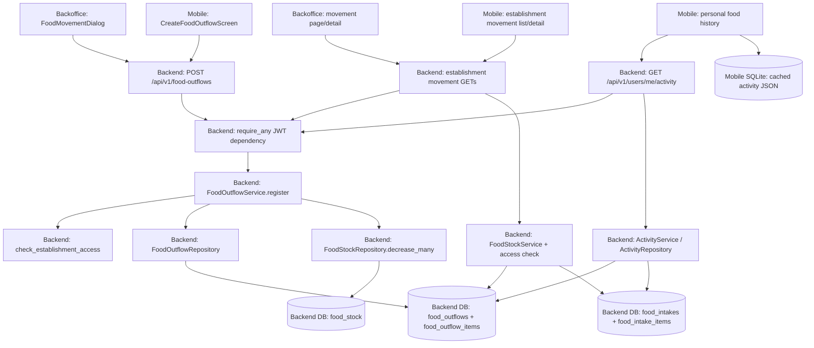

# Research: Food Outflow Category

> **Feature:** Record why food leaves stock and show that category in the web and mobile histories (backend #182, backoffice #88, mobile #83).
> **Date:** 2026-10-10
> **Repos in scope:** backend, backoffice, app_mobile
> **Worktree set:** `1-categoria-egresos-alimentos` (local paths recorded in `.context/feature-worktrees/`)
> **Backend commit:** `d8e601b` on `feature/categor-a-obligatoria-egresos`, aligned with `origin/develop`
> **Backoffice commit:** `07eafa0` on detached feature worktree, aligned with `origin/develop`
> **Mobile commit:** `240f2a4` on detached feature worktree, aligned with `origin/develop`

## 1. Overview — Current State

The backend records food leaving an establishment through `POST /api/v1/food-outflows`. A client may supply a UUID so the same submission can be retried: an existing ID returns the stored outflow with HTTP 200 without spending stock again. A new outflow resolves the establishment, checks the actor's access, validates foods, inserts the header and lines, and subtracts aggregated quantities from materialized stock in one transaction. An uncovered quantity returns 409 and the transaction leaves no outflow or partial deduction. The outflow header currently stores an optional free-text `comments` field and a `source` (`manual` or `photo`) describing how the record was loaded. It has no disposition category.

Backoffice has one `FoodMovementDialog` for intakes and outflows. For an outflow, it offers food lines from available stock and always shows an optional comments box. It sends the same request shape as an intake, using a different endpoint. Mobile has a dedicated outflow screen and ViewModel; it also always shows optional comments and submits no category. Both clients already translate a backend 422 into Spanish without clearing the form. Their current `category` controls filter **catalog foods in stock**; they do not describe where an outflow went.

There are two establishment history calls: a paginated mixed-direction summary list and a separate full movement detail. Both clients use them. The backend also publishes the caller's own food movements through `GET /api/v1/users/me/activity`, which mobile displays in its personal food history and caches locally. None of the three read shapes includes an outflow category today. The detail and personal activity payloads include comments; the establishment summary does not.

The three feature worktrees were initialized from freshly fetched `origin/develop` commits. This Conductor backend workspace had originally been created from `origin/main` (`4bc806d`), where the food outflow module was absent; its existing feature branch was moved to `origin/develop` before this research. No product implementation is part of this document.

## 2. Relevant Files & Components

Paths are relative to the named repository. Files grouped in one row participate in the same current flow.

| Repo | File | Layer | Current role |
| --- | --- | --- | --- |
| backend | `alembic/versions/c8e3d5a91f74_add_food_outflow_and_stock_tables.py` | DDL | Creates outflow, line, and balance tables. |
| backend | `alembic/versions/b4f1a7c2e590_add_food_intake_tables.py`, `f3b9e1a7c204_rename_food_intakes_received_at_to_occurred_at.py`, `ec7aacdaf1ae_feat_add_photo_key_to_food_intakes.py` | DDL | Define the incoming half of the shared movement history. |
| backend | `alembic/versions/a1c6b8d47e02_add_responsible_composite_indexes_to_food_movements.py` | DDL | Adds personal-activity lookup indexes. |
| backend | `app/models/food_outflows/food_outflow.py`, `food_outflow_item.py` | ORM | Map outflow header and lines; header has comments but no category. |
| backend | `app/models/food_stock/food_stock.py`, `app/models/food_intakes/food_intake.py`, `food_intake_item.py` | ORM | Map balance and incoming movements. |
| backend | `app/repositories/food_outflows/food_outflow_repository.py` | data access | Insert with ID-conflict savepoint and eager replay lookup. |
| backend | `app/repositories/food_stock/food_stock_repository.py` | data access | Atomic balance changes, mixed movement summaries and detail. |
| backend | `app/repositories/activity_repository.py` | data access | Caller-owned activity union and outflow hydration. |
| backend | `app/api/v1/food_outflows.py`, `app/schemas/food_outflows/food_outflow_schema.py` | HTTP/schema | POST contract, success/replay status, request/response fields. |
| backend | `app/domain/food_outflow.py`, `app/services/food_outflows/food_outflow_service.py` | domain/service | Outflow domain and transaction flow. |
| backend | `app/api/v1/establishments/stock.py`, `app/services/food_stock/food_stock_service.py` | HTTP/service | Establishment stock and movement listing/detail. |
| backend | `app/domain/food_stock.py`, `app/schemas/food_stock/food_stock_schema.py` | domain/schema | Mixed-direction summary/detail shapes. |
| backend | `app/api/v1/users.py`, `app/services/activity_service.py`, `app/domain/activity.py`, `app/schemas/activity_schema.py`, `app/schemas/food_movements/food_movement_schema.py` | activity | Personal feed and its food-outflow payload. |
| backend | `app/core/dependencies.py`, `app/services/access.py`, `app/exceptions/exception_handlers.py`, `app/exceptions/domain_exceptions.py` | cross-cutting | Authentication, establishment access, 422/409 envelopes. |
| backend | `app/api/v1/food_intakes.py`, `app/schemas/food_intakes/food_intake_schema.py` | intake | Separate intake route; outflow reuses only food-line schema. |
| backend | `docs/generate_openapi.py`, `tests/integration/food/stock/test_register.py`, `test_movements.py`, `tests/unit/food/test_food_stock_services.py` | contract/tests | Generated OpenAPI source and present regression coverage. |
| backoffice | `components/FoodMovementDialog.tsx`, `components/MovementFoodPicker.tsx`, `hooks/useMovementFoodOptions.ts` | UI | Shared movement form and food/stock picker. |
| backoffice | `schemas/foodMovement.schema.ts`, `hooks/useCreateFoodMovement.ts`, `services/foodMovement.service.ts`, `types/establishment.ts` | validation/client | Form rules, replay handling, POST payload and response types. |
| backoffice | `app/dashboard/establishments/[id]/stock/movements/page.tsx`, `MovementDetailPanel.tsx`, `hooks/useEstablishmentMovementsHistory.ts`, `services/establishment.service.ts` | history | Paginated mixed movement list and on-demand detail. |
| backoffice | `constants/api.ts`, `constants/establishments.ts`, `constants/errors.ts`, `lib/apiError.ts`, `lib/errorMessages.ts` | shared | Endpoints, Spanish labels, RFC 7807 error translation. |
| backoffice | `mocks/handlers/foodMovement.ts`, `mocks/handlers/establishment.ts`, `mocks/fixtures/establishment.ts`, related component/schema/service tests | test data | Simulated contract, 200 replay, 409, history. |
| mobile | `composeApp/src/commonMain/kotlin/ar/com/ingenieriaalimentacion/presentation/feature/food/create_food_outflow/` | UI/ViewModel | Outflow fields, local validation, submit, error display. |
| mobile | `composeApp/src/commonMain/kotlin/ar/com/ingenieriaalimentacion/domain/model/food/NewFoodOutflow.kt`, `domain/repository/FoodOutflowRepository.kt`, `domain/usecase/food/CreateFoodOutflowUseCase.kt` | domain | New outflow passed from ViewModel to repository. |
| mobile | `composeApp/src/commonMain/kotlin/ar/com/ingenieriaalimentacion/data/food/FoodOutflowApi.kt`, `FoodOutflowRepositoryImpl.kt`, `dto/FoodOutflowRequest.kt`, `dto/FoodOutflowResponse.kt`, `dto/FoodOutflowProblem.kt`, `mapper/FoodOutflowMapper.kt` | data/client | POST JSON, response and error mapping. |
| mobile | `composeApp/src/commonMain/kotlin/ar/com/ingenieriaalimentacion/data/food/{FoodMovementActivityApi,EstablishmentFoodMovementApi}.kt`, related DTOs/mappers/domain models | data/client | Personal and establishment history reads. |
| mobile | `composeApp/src/commonMain/kotlin/ar/com/ingenieriaalimentacion/presentation/feature/food/{food_movement_history,establishment_food_movement_history,establishment_food_movement_detail}/` | UI | Cached personal history, establishment list/detail. |
| mobile | `composeApp/src/commonMain/kotlin/ar/com/ingenieriaalimentacion/di/`, `data/network/HttpClientFactory.kt` | wiring | Authenticated API clients, repository, use case, ViewModel; tolerant JSON decoding. |

## 3. Database Schema

Alembic revisions are the DDL source of truth. The ORM files were compared with the composed migration chain. The five relevant tables' current ORM columns and key/check constraints agree with that chain. This was a source-level reconciliation, not a comparison against a deployed database: dependencies were not installed, so `poetry run alembic heads` was unavailable. Parsing revision parents found one current head, `7d3e9a1b5c24`.

### `food_outflows`

Created in `c8e3d5a91f74`; responsible index added by `a1c6b8d47e02`. No category column, category enum, category constraint, or default exists. `comments` has no DB-level length or category condition.

| Column | PostgreSQL type | Constraints and default |
| --- | --- | --- |
| `id` | UUID | Primary key; ORM-side UUID default, no creation-migration server default. |
| `establishment_id` | UUID | Not null; FK `establishments.id`, `ON DELETE RESTRICT`. |
| `responsible_id` | UUID | Not null; FK `users.id`, `ON DELETE RESTRICT`. |
| `occurred_at` | timestamptz | Not null. |
| `comments` | varchar | Nullable, unrestricted in DDL. |
| `source` | enum `foodoutflowsource` | Not null; `manual`, `photo`. |
| `synced_at` | timestamptz | Nullable. |
| `created_at` | timestamptz | Not null; server default `now()`. |

Indexes: primary key; `ix_food_outflows_establishment_id_occurred_at` on `(establishment_id, occurred_at)`; `ix_food_outflows_responsible_id_occurred_at` on `(responsible_id, occurred_at)`. The primary key is the only uniqueness constraint.

### `food_outflow_items`

Created in `c8e3d5a91f74`.

| Column | PostgreSQL type | Constraints and default |
| --- | --- | --- |
| `id` | UUID | Primary key; ORM-side UUID default. |
| `food_outflow_id` | UUID | Not null; FK `food_outflows.id`, `ON DELETE CASCADE`. |
| `food_id` | UUID | Not null; FK `foods.id`, `ON DELETE RESTRICT`. |
| `quantity` | numeric(10,3) | Not null; `ck_food_outflow_items_quantity_positive` (`quantity > 0`). |
| `created_at` | timestamptz | Not null; server default `now()`. |

Indexes: primary key, `ix_food_outflow_items_food_outflow_id`, `ix_food_outflow_items_food_id`. There is no uniqueness constraint on `(food_outflow_id, food_id)`; repeated food lines are preserved.

### `food_stock`

Created in `c8e3d5a91f74`.

| Column | PostgreSQL type | Constraints and default |
| --- | --- | --- |
| `id` | UUID | Primary key; ORM-side UUID default. |
| `establishment_id` | UUID | Not null; FK `establishments.id`, `ON DELETE RESTRICT`. |
| `food_id` | UUID | Not null; FK `foods.id`, `ON DELETE RESTRICT`. |
| `quantity` | numeric(10,3) | Not null; `ck_food_stock_quantity_non_negative` (`quantity >= 0`). |
| `created_at` | timestamptz | Not null; server default `now()`. |
| `updated_at` | timestamptz | Not null; server default `now()`; ORM `onupdate`, with repository updates setting it explicitly. |

Primary key and unique constraint `uq_food_stock_establishment_id_food_id` on `(establishment_id, food_id)`. Zero-balance rows remain present.

### `food_intakes`

Created in `b4f1a7c2e590`; event time renamed from `received_at` by `f3b9e1a7c204`; `photo_key` added by `ec7aacdaf1ae`. This table feeds the incoming half of both history read paths.

| Column | PostgreSQL type | Constraints and default |
| --- | --- | --- |
| `id` | UUID | Primary key; ORM-side UUID default. |
| `establishment_id` | UUID | Not null; FK `establishments.id`, `ON DELETE RESTRICT`. |
| `responsible_id` | UUID | Not null; FK `users.id`, `ON DELETE RESTRICT`. |
| `occurred_at` | timestamptz | Not null. |
| `comments` | varchar | Nullable. |
| `source` | enum `foodintakesource` | Not null; `manual`, `photo`; a distinct PostgreSQL enum from outflow source. |
| `photo_key` | varchar | Nullable. |
| `synced_at` | timestamptz | Nullable. |
| `created_at` | timestamptz | Not null; server default `now()`. |
| `updated_at` | timestamptz | Not null; server default `now()`; ORM `onupdate`. |

Indexes: primary key; `ix_food_intakes_establishment_id_occurred_at` and `ix_food_intakes_responsible_id_occurred_at`.

### `food_intake_items`

Created in `b4f1a7c2e590`.

| Column | PostgreSQL type | Constraints and default |
| --- | --- | --- |
| `id` | UUID | Primary key; ORM-side UUID default. |
| `food_intake_id` | UUID | Not null; FK `food_intakes.id`, `ON DELETE CASCADE`. |
| `food_id` | UUID | Not null; FK `foods.id`, `ON DELETE RESTRICT`. |
| `quantity` | numeric(10,3) | Not null; `ck_food_intake_items_quantity_positive` (`quantity > 0`). |
| `created_at` | timestamptz | Not null; server default `now()`. |

Indexes: primary key, `ix_food_intake_items_food_intake_id`, `ix_food_intake_items_food_id`; no uniqueness constraint on `(food_intake_id, food_id)`.

## 4. Key Code Snippets

### `FoodOutflowService.register` (backend) — idempotency and stock

```python
if data.id is not None:
    existing = await self.uow.food_outflow_repo.get_by_id(data.id)
    if existing is not None:
        return FoodOutflowDomain.from_db(existing), False

await self.uow.establishment_repo.get_by_id_or_raise(data.establishment_id)
await check_establishment_access(self.uow, actor, data.establishment_id)
# The service then resolves foods and builds the outflow and its lines.
try:
    await self.uow.food_outflow_repo.create(outflow)
except UniqueConstraintError:
    # A concurrent insert of the same id is handled as a replay.
    ...
await self._spend(data.establishment_id, aggregate_quantities(data.items))
await self.uow.commit()
```

The repository's insert uses a savepoint and recognizes only a primary-key collision as a replay candidate. A concurrent collision is caught and read back. Replay is by ID; payload equality is not checked. The stock repository subtracts with `UPDATE ... WHERE quantity >= requested` and returns the foods it could cover. The service raises `InsufficientStockError` for any missing food, producing HTTP 409 with `food_id`, `requested`, and `available`; the unit of work rolls back. Existing unit and integration tests cover replay and all-or-nothing stock behavior.

### `FoodOutflowRequest` (backend) — present wire fields

```python
class FoodOutflowRequest(BaseModel):
    id: ClientGeneratedId
    establishment_id: UUID
    occurred_at: datetime
    comments: str | None = Field(default=None, max_length=500)
    source: FoodOutflowSource = FoodOutflowSource.MANUAL
    items: list[FoodLineRequest] = Field(min_length=1)
```

`ClientGeneratedId` is optional; omission lets the server create a UUID. `occurred_at` also has a not-future validator. Response and domain models likewise lack category. The `source` values `manual` and `photo` identify entry method; they are separate from the feature's proposed disposition values.

### `FoodStockRepository` and read models (backend) — movement projections

```python
return select(
    source.model.id.label("id"),
    literal(direction.value).label("direction"),
    source.occurred_at.label("occurred_at"),
).where(*conditions)
```

The intake/outflow branches are `UNION ALL`ed and paginated. Summary hydration currently supplies only responsible and distinct food count. Detail probes both tables for a matching movement ID **within the requested establishment**, loads lines and responsible, and projects `comments` and `source`. The personal activity feed uses another union restricted by `responsible_id` and loads the outflow's establishment and lines. Its common food movement payload also lacks category.

### `FoodMovementDialog` (backoffice) — one form for both directions

```ts
const body = {
  id: entryId,
  establishment_id: establishmentId,
  occurred_at: value.date === today
    ? new Date().toISOString()
    : argentineDayStartUtc(value.date)!,
  comments: value.comments.trim() || null,
  source: "manual" as const,
  items: value.lines.map((line) => ({
    food_id: selectedFoodId(line.food!),
    quantity: apiQuantity(line.quantity),
  })),
};
const saved = await save.submit(direction, body);
```

The Zod form schema has `direction`, `date`, `comments` (max 500), and one or more lines. Comments are visible for either direction. `useCreateFoodMovement` freezes the *complete request body* after an ambiguous failure and resends it unchanged with the same ID; confirmed 422/409 errors release that frozen state and leave the form populated. The history list opens a separate detail panel to show comments.

### `CreateFoodOutflowViewModel` and `FoodOutflowApi` (mobile) — submit and errors

```kotlin
val canSubmit: Boolean
    get() = isOnline && !isSubmitting && selectedEstablishment != null && lines.isNotEmpty()

// FoodOutflowApi.kt maps both response statuses to creation or replay success.
200, 201 -> FoodOutflowUploadOutcome.Created(response.body())
400, 422 -> FoodOutflowUploadOutcome.InvalidData
```

The ViewModel holds one `outflowId`, date, comments and lines; its mapper emits `FoodOutflowRequest` without category. A 422 becomes a generic Spanish outflow validation message while state remains populated. A 409 reads insufficient-stock extensions and refreshes stock. The screen's current “Categoría” picker filters catalog foods, not outflow disposition.

### `FoodMovementHistoryRepositoryImpl` (mobile) — cached personal feed

The mobile API requests `GET /api/v1/users/me/activity` with both `type=food_intake` and `type=food_outflow`. It maps the nested outflow payload to a `@Serializable FoodMovement` and stores that model as JSON in `CachedActivityItem.payloadJson` before presenting it. The establishment list/detail API is independent and is mapped to a separate model. Current personal and establishment UI models have no outflow category.

## 5. Data Flow & Architecture

### Diagram



### Narrative

1. Web generates `entryId` when a draft starts. Mobile creates `outflowId` when its ViewModel starts. Both send an authenticated JSON POST with establishment, time, optional comments, `manual` source and food lines.
2. FastAPI/Pydantic validates the request before `FoodOutflowService.register` runs. `require_any` authenticates any current role. The service returns an existing ID immediately; otherwise it resolves establishment and foods and calls the shared establishment access check.
3. The outflow header and original lines are inserted. Duplicate food lines are aggregated only for the conditional stock deduction. The transaction commits only after every requested quantity is covered.
4. An establishment history request passes `require_any` and `FoodStockService._resolve_establishment`, then gets a merged intake/outflow page. Opening a row makes a second GET for full detail. Web and mobile consume this pair.
5. Mobile also requests the caller's activity with two food movement `type` filters. The backend limits rows to the responsible actor. Mobile maps the food payload to its personal history model and stores JSON in its local activity cache.

## 6. Cross-Repo Contracts

| Contract | Producer | Current consumers and payload | Breaking to change? |
| --- | --- | --- | --- |
| `POST /api/v1/food-outflows` | Backend `food_outflows.py`, `FoodOutflowRequest`/`Response` | Backoffice `foodMovement.service.ts` and mobile `FoodOutflowApi.kt`. JSON: optional `id`, required `establishment_id`, `occurred_at`, nonempty `items[{food_id,quantity}]`, optional `comments`, `source=manual` default. Response also has `responsible_id`, `created_at`, resolved lines. 201 new / 200 replay. | Adding a required request field breaks current mobile installations and the current backoffice client: both omit it. A deployed old mobile build would receive 422. |
| `GET /api/v1/establishments/{id}/food-movements` | Backend stock route and summary schema | Backoffice page and mobile establishment history. Paginated `{items,total,page,page_size,total_pages}`; each item `{id,direction,occurred_at,responsible,food_count}`. | Adding a response field is generally additive; both client models currently omit it, so they cannot display it. |
| `GET /api/v1/establishments/{id}/food-movements/{movement_id}` | Backend stock route and detail schema | Backoffice detail panel and mobile establishment detail. `{id,direction,occurred_at,source,comments,responsible,items}`. | A new response field is additive at the wire level; existing client models do not present it. |
| `GET /api/v1/users/me/activity?type=food_intake&type=food_outflow` | Backend users route/activity schema | Mobile personal food history and SQLite activity cache. An outflow entry has `type=food_outflow` and nested `food_outflow:{id,occurred_at,establishment,source,comments,items}`. | New payload fields are ignored by the current Kotlin decoder (`ignoreUnknownKeys=true`); old builds will not display them. Model serialization changes can affect already cached JSON. |
| Validation and insufficient stock | Backend exception handlers | Both clients translate RFC 7807 `type`. Missing/invalid request fields return 422 `/errors/validation-failed` with a generic English `detail` and no field-level location. Insufficient stock returns 409 `/errors/insufficient-stock` with `food_id`, `requested`, `available`. | The current clients retain draft state on a confirmed 422. Backoffice has a generic Spanish translation, and mobile maps 422 to a generic Spanish outflow message. |
| `POST /api/v1/food-intakes` | Backend intake route | Backoffice's same dialog in `in` mode and mobile intake flow. The intake body has the existing optional comments contract. | The outflow stories explicitly leave this contract unchanged. |

The backend's generated OpenAPI source is the FastAPI application (`docs/generate_openapi.py`); no generated backend JSON is checked into this worktree. `docs/api.md` has no food-outflow entry. Mobile's checked-in `docs/backend.openapi.generated.json` does **not** contain `/api/v1/food-outflows` or either establishment movement path, so it is stale for this feature. The route and Pydantic schema files above were used as the current contract.

## 7. Auth & Permissions

`require_any` accepts authenticated `admin`, `superadmin`, `analyst`, and `field_worker` actors on the POST and read routes. The JWT supplies actor ID and role, not establishment membership. The shared `app/services/access.py::check_establishment_access` performs the request-time lookup; only field workers need an approved `user_establishments` relation. Registration calls it after the existing-ID replay check. Establishment list and detail call it through `FoodStockService._resolve_establishment`. `GET /api/v1/users/me/activity` is already caller-scoped via `responsible_id` and therefore does not perform an establishment access lookup. There is no establishment permission middleware in this checkout; service-level checks are the current design, as documented in `docs/auth.md`.

The backoffice uses an authorized dispatcher and the mobile data layer an authenticated Ktor client. Neither client component defines the backend's establishment permission rule.

## 8. Key Dependencies & Integrations

- FastAPI and Pydantic define the request, response and OpenAPI contracts. SQLAlchemy async sessions and PostgreSQL store movements and conditional stock changes. Alembic owns schema changes.
- `IUnitOfWork`/`UnitOfWork` bind outflow, stock and activity repositories to one async session. The 409 path relies on transaction rollback; the 200 replay path relies on the outflow UUID primary key.
- Backoffice uses React Hook Form with Zod, an authenticated dispatcher, Spanish error mappings and MSW fixtures. It also freezes ambiguous writes for an identical retry.
- Mobile uses Compose UI, a ViewModel/domain/data chain, Kotlin serialization (`ignoreUnknownKeys=true`, `encodeDefaults=true`), Koin wiring and SQLite-backed activity caching.
- The stock food category (`foods.category_id`, stock filtering and both clients' food pickers) is a catalog classification. The requested outflow category is a different business datum.
- Existing tests cover stock rollback and 409, web request replay, mobile 200/201 and 422 handling, and exact-key assertions for establishment movement summary/detail. They currently use category-free outflow payloads.

## 9. Open Questions & Gaps

1. The backend acceptance criterion says “history readings return category in each outflow.” The current product has three distinct read shapes: establishment summary, establishment detail, and personal activity. The story does not identify which of those shapes are intended by “history,” while web and mobile use more than one.
2. A newly required POST field will cause existing mobile builds to receive 422 until they are updated. Kotlin ignores new response fields but cannot add a missing request field on an installed build. The stories do not specify the rollout relationship between API and mobile releases.
3. Existing `comments` values are unconstrained and may contain the only recorded description of a prior outflow. The story explicitly maps old rows to `other` while preserving that text; the current DDL gives no further origin classification to infer.
4. The backend 422 envelope does not expose the invalid field. The clients have only a generic Spanish message for backend 422, although they perform local field validation.
5. Current mobile personal history caches its domain model as JSON and skips cached rows it can no longer deserialize. The effect of any model-shape change on older cached rows needs attention during planning.
6. No applied database was inspected, and the Alembic CLI was unavailable in this checkout. Source migrations and ORM agree for the five relevant tables; the parsed revision graph has one head.

## 10. Self-Check

- **Lanes covered:** API data, API backend, cross-cutting auth/error/OpenAPI, backoffice, and mobile. Each assigned file group was inspected; no assigned lane was skipped.
- **Flows:** The POST reaches transaction/stock tables; establishment reads reach both movement tables; personal activity reaches outflow hydration and mobile cache. No traced path stops at a repository boundary.
- **Schema:** All columns, FKs, checks, defaults and indexes for the five directly involved food tables are listed. The intake rename/photo-key migrations were accounted for. Source-level ORM/migration comparison found no relevant drift; live DB verification was unavailable.
- **Snippets and diagram:** Registration, request schema, read query, web body, mobile handling and cache are represented above; the diagram matches the numbered narrative, including `require_any` and service-level establishment access.
- **Contracts:** Section 6 names each method, path and payload, including the personal activity feed and the unaffected intake POST. The main unknown for planning is how the mandatory POST contract is coordinated with already installed mobile builds.
